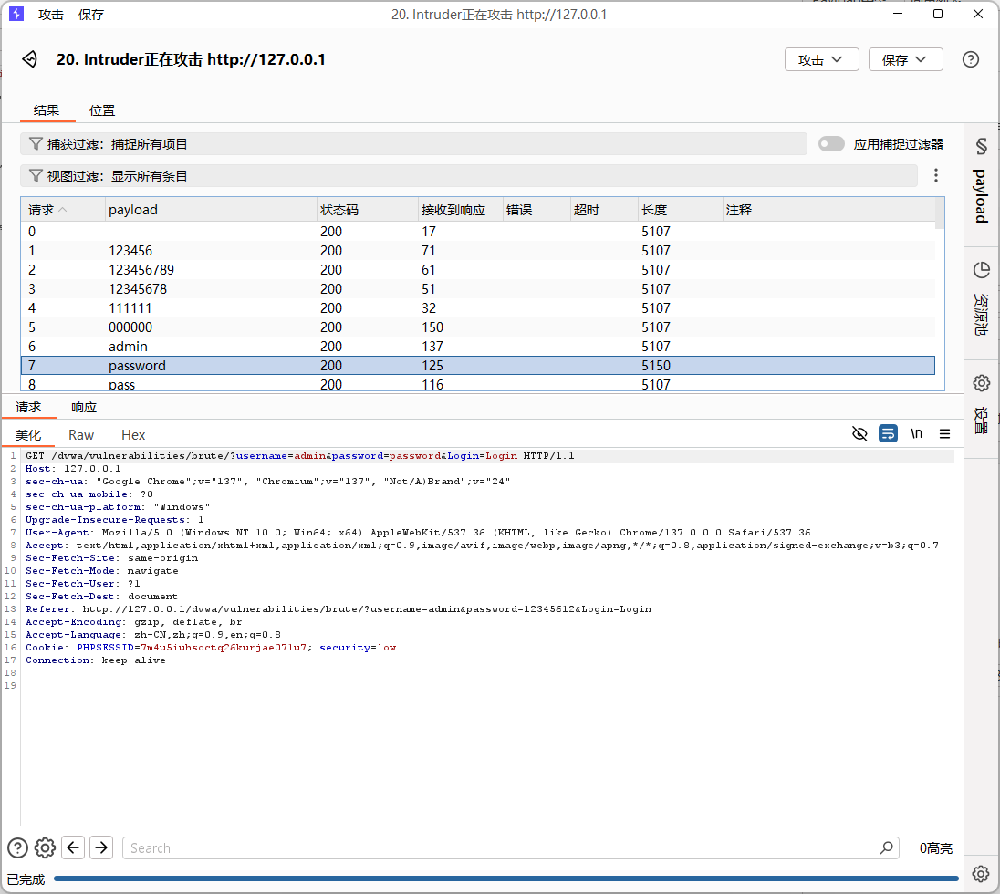
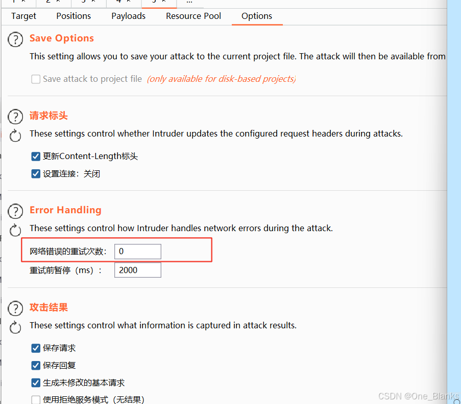
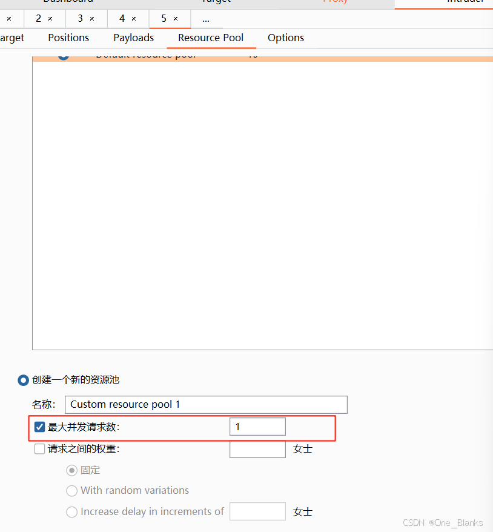
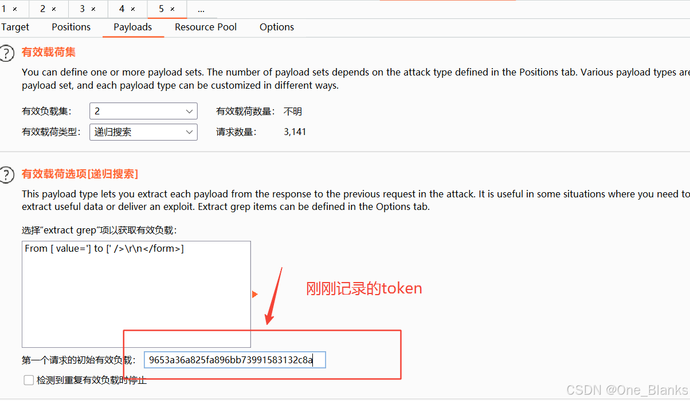
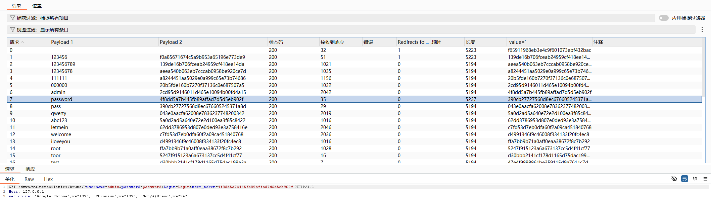
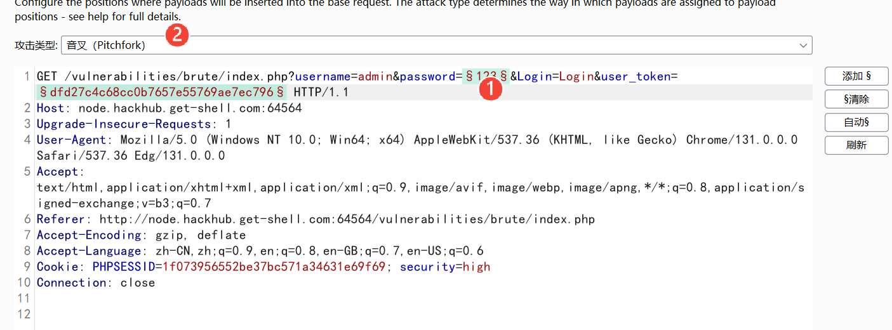

# Brute Force

登录框，用户名密码，没有验证码没有锁定。这个模块练的是"密码猜错一万次会怎样"。

四档的区别只有一条线：服务器给爆破加了多少阻力。

| 等级 | 加了什么 | 效果 |
|---|---|---|
| Low | 什么都没有 | 直接跑字典，几分钟出结果 |
| Medium | 失败后 `sleep(2)` | 慢，但还是能跑完 |
| High | 每次请求带一次性 token | 工具默认配置跑不了，要配宏 |
| Impossible | 失败锁定 + token + 参数化查询 | 路子基本堵死 |

## Low

源码：

```php
$user = $_GET['username'];
$pass = md5($_GET['password']);
$query = "SELECT * FROM users WHERE user = '$user' AND password = '$pass';";
```

密码明文走 GET、没有次数限制、没有验证码、成功和失败的提示不一样、还顺手带了个 SQL 注入。基本是把所有该有的防护都省掉了。

### Burp Intruder

1. 浏览器代理指到 `127.0.0.1:8080`，Burp 打开 `Proxy → Intercept`。
2. 页面上输 `admin` 加随便一个密码，点 login。
3. 抓到请求后右键 `Send to Intruder`。
4. `Positions` 里点 `Clear §`，只把密码那一段选中，点 `Add §`。请求变成：

```
GET /dvwa/vulnerabilities/brute/?username=admin&password=§123456§&Login=Login HTTP/1.1
```

5. `Payloads` 里 `Payload type` 选 `Simple list`，把字典粘进去。
6. `Start attack`。

结果看两个地方：`Length` 和状态码。失败的响应里带 `Username and/or password incorrect.`，成功的那条带 `Welcome to the password protected area`。长度会明显不一样，排序一下就在最上面。



### Hydra

不想开 Burp 的时候用命令行。GET 表单的写法：

```bash
hydra -l admin -P passwords.txt 127.0.0.1 http-get-form \
"/dvwa/vulnerabilities/brute/:username=^USER^&password=^PASS^&Login=Login:Username and/or password incorrect.:H=Cookie: PHPSESSID=你的session; security=low"
```

几个参数得说清楚：

- `^USER^` 和 `^PASS^` 是 Hydra 的占位符，不是让你替换的
- 冒号分隔的第三段是失败特征，Hydra 拿它判断这次有没有中
- `H=Cookie:` 后面必须带 PHPSESSID，否则每个请求都是未登录，全失败
- PHPSESSID 从浏览器 F12 或者 Burp 里拿，会过期，跑之前重新取一次


## Medium

只加了一条：失败以后 `sleep(2)`。

```php
if ($total == 1) {
    echo "Welcome";
} else {
    sleep(2);
    echo "Username and/or password incorrect.";
}
```

拿 1000 条字典算一下，1000 × 2 秒 = 2000 秒，大概 33 分钟。听着久，但没别的防护，挂着跑就行。Burp 里 Intruder 的线程数会明显拉低吞吐，实际速度取决于服务器能扛多少并发。

Hydra 的命令不用改，只把 cookie 里的 `security=medium` 换掉。

这个"防护"为什么不算防护：它只降低单线程速度。攻击方多开线程、换分布式、或者换成更小更准的字典（比如只试常见弱口令几百条），时间成本立刻降下来。真正管用的是失败锁定和验证码。

## High

High 加了 `user_token`，每次请求都不一样，验不过就跳 302。第一次抓到的是 200，后面全是 302，原因就在这里。

只改密码那一格是跑不动的：第一个请求 token 对，后面全废。

### 用宏让它自动换 token

1. `Settings → Sessions → Session handling rules → Add`，新建一条规则，作用范围勾上 Intruder。
2. 规则里加一个 `Macro`，`Add` 之后选一个**不消耗 token 的请求**。这里用直接访问 `/dvwa/vulnerabilities/brute/` 的 GET，因为它返回的页面里带一个新 token，但不会把它用掉。
3. 宏里选中响应，点 `Configure item`，搜 `user_token`，把引号中间那一串选中，参数名填 `user_token`。Burp 会自动带上前后文，点确定。
4. 回 Intruder 的 `Positions`，除了密码那一格，再加一格给 `user_token`，攻击类型选 `Pitchfork`（草叉），两个 payload 各走各的。
5. `Options` 里把 `Follow redirections` 设成 `Always`，这样成功登录也返 200，跟失败区分得开。
6. `Network error retry` 设 0。token 一次性，重试等于拿废 token 再打一次，只会添乱。
7. 并发设 1。token 必须逐个用，并发会互相抢。











整个流程一句话：High 爆破的关键不是字典，是让 Burp 在每次请求之前自动去拿一个新 token 填进去。



## Impossible 为什么打不进去

```php
$stmt = $db->prepare('SELECT failed_login, last_login FROM users WHERE user = ?');
$stmt->bind_param('s', $user);
```

四层：连续失败三次锁 15 分钟、CSRF token、参数化查询、成功失败提示统一（不告诉你到底是用户名错还是密码错）。

锁 15 分钟这条是决定性的。字典再大，每个账号只有三次机会，爆破的成本从"几小时"变成"按年算"。

## 我卡住的地方

- 一开始没看懂 200 和 302 混在一起是什么意思。后来才想明白，302 是 token 失效被踢回登录页，200 才是真的验了一次密码。
- 宏里选错了请求。第一次选了登录请求本身，那个请求会把 token 用掉，宏拿到的永远是过期的。必须是那个只生成不消费的页面。
- `Pitchfork` 和 `Cluster bomb` 试混了。Pitchfork 是两列一一对应，Cluster bomb 是笛卡尔积，这里要用前者，否则请求数会翻成天文数字。

## 怎么修

1. 失败锁定。连续 N 次失败锁一段时间，或者加指数退避。
2. 验证码。不是每次都弹，失败两次后弹就够。
3. 提示统一。别区分"用户不存在"和"密码错误"。
4. 密码强度策略 + 撞库检测。同一个 IP 换着账号试同一批密码，这是撞库的特征，比单账号爆破更该拦。
5. 强哈希存储（bcrypt / Argon2），别用裸 MD5。这一条和爆破没直接关系，但数据库被拖走的时候差别很大。
