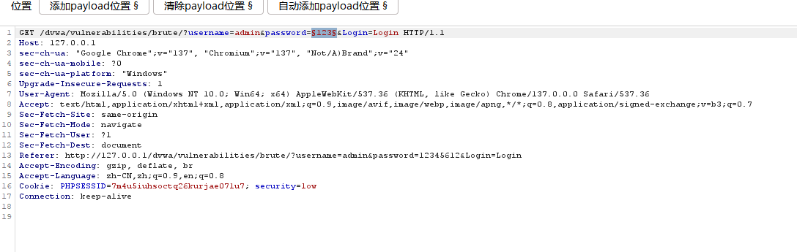
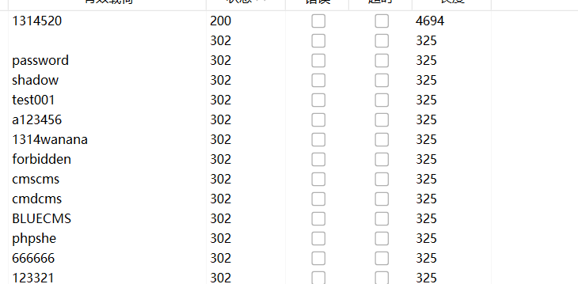
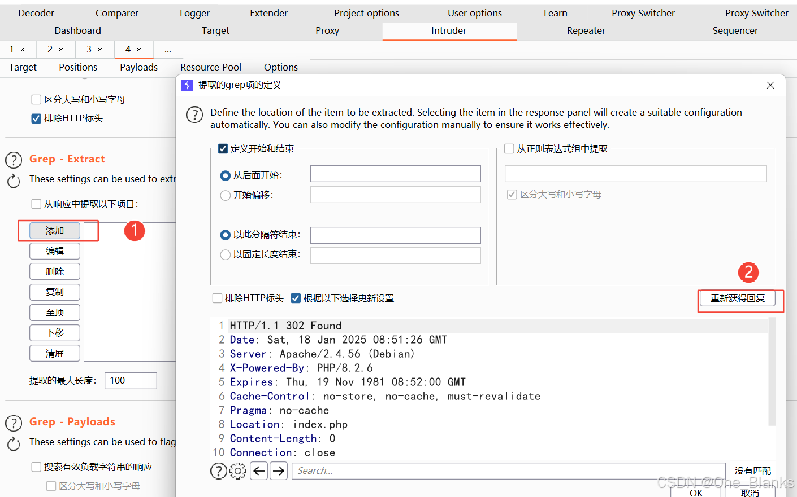
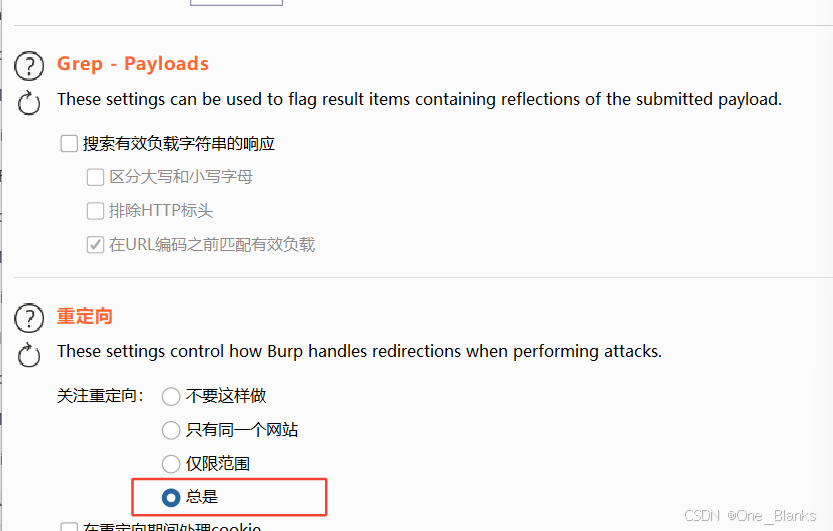
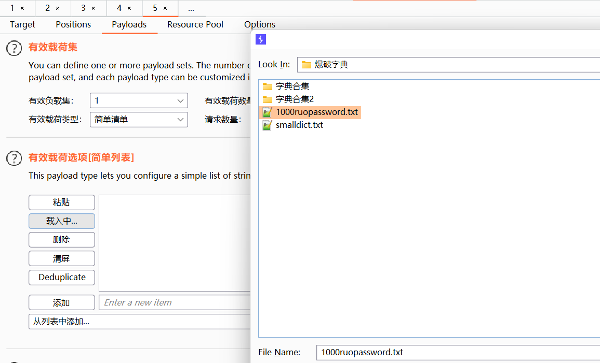

# Brute Force

登录框没有验证码、没有次数限制、成功与失败提示不同。这个模块练的是服务器给爆破加了多少阻力，四档的区别只在这条线上。

## 漏洞在哪

```php
$user = $_GET['username'];
$pass = md5($_GET['password']);
$query = "SELECT * FROM users WHERE user = '$user' AND password = '$pass';";
```

密码走 GET、无失败锁定、无验证码、响应可区分成功失败，还顺带一个 SQL 注入。

## 等级对照

| 等级 | 防护 | 本机结果 |
|---|---|---|
| Low | 无 | Intruder 与 Hydra 均几分钟出结果 |
| Medium | 失败后 `sleep(2)` | 仍可跑完，只是慢 |
| High | 每次请求带一次性 token | 配宏后爆破成功 |
| Impossible | 失败锁定 + token + 参数化查询 | 打不进去 |

## Low

| 项 | 内容 |
|---|---|
| 抓包 | 代理到 `127.0.0.1:8080`，输任意账号密码点登录 |
| 打点 | 只把密码参数加 `§`，用户名固定 |
| 判据 | 失败响应含 `Username and/or password incorrect.`，成功含 `Welcome to the password protected area` |
| 结果 | 长度排序后成功的那条在最上面 |

```
GET /dvwa/vulnerabilities/brute/?username=admin&password=§123456§&Login=Login HTTP/1.1
```

Intruder 配置：`Positions` 里 `Clear §` 后只框住密码；`Payloads` 选 `Simple list` 粘字典；`Start attack` 后按 `Length` 排序。

命令行等价写法：

```bash
hydra -l admin -P passwords.txt 127.0.0.1 http-get-form \
"/dvwa/vulnerabilities/brute/:username=^USER^&password=^PASS^&Login=Login:Username and/or password incorrect.:H=Cookie: PHPSESSID=你的session; security=low"
```

三个参数容易写错：`^USER^` 与 `^PASS^` 是占位符不能替换；第三段冒号后是失败特征；`H=Cookie:` 后面必须带有效的 PHPSESSID，否则每个请求都是未登录。




## Medium

| 项 | 内容 |
|---|---|
| 防护 | 失败后 `sleep(2)`，其余不变 |
| 成本 | 1000 条字典约 33 分钟 |
| 处理 | 命令不变，只把 cookie 里的 `security=medium` 换掉 |

```php
if ($total == 1) { echo "Welcome"; }
else { sleep(2); echo "Username and/or password incorrect."; }
```

延迟只降低单线程速度。多线程、分布式、换更小更准的字典，任一招都能把时间压回去。真正管用的是锁定和验证码。

## High

| 项 | 内容 |
|---|---|
| 防护 | 每次请求校验 `user_token`，验不过跳 302 |
| 现象 | 只有第一条 200，其余全 302 |
| 打法 | Burp 宏自动取新 token，并发设 1 |
| 结果 | 200 出现即命中 |

宏的关键是选一个**不消耗 token 的请求**：直接 GET `/dvwa/vulnerabilities/brute/`，它返回新 token 但不使用。若把登录请求本身设成宏，拿到的永远是过期的。

配置步骤：

| 步骤 | 动作 |
|---|---|
| 1 | `Settings → Sessions → Session handling rules → Add`，作用域勾 Intruder |
| 2 | 规则内加 Macro，选中上面那个 GET |
| 3 | `Configure item` 里搜 `user_token`，框住引号内的值，命名参数 |
| 4 | `Positions` 里除密码外再加一格 token，攻击类型选 `Pitchfork` |
| 5 | `Options` 中 `Follow redirections` 设 `Always` |
| 6 | `Network error retry` 设 0，token 一次性，重试只会拿废值再打 |
| 7 | 并发设 1，token 必须逐个使用 |












## Impossible

```php
$stmt = $db->prepare('SELECT failed_login, last_login FROM users WHERE user = ?');
$stmt->bind_param('s', $user);
```

四层防护：连续失败三次锁 15 分钟、CSRF token、参数化查询、成功失败提示统一。

锁定是决定性的。每个账号只有三次机会，成本从"几小时"变成"按年算"。

## 容易记错的地方

- 200 与 302 混在一起不是报错，302 表示 token 失效被踢回登录页。
- 宏里选错请求是最常见失败原因，必须是只生成不消费的那个页面。
- `Pitchfork` 是两列一一对应，`Cluster bomb` 是笛卡尔积，这里只能用前者。
- 只改密码那一格不加 token 格，前面成功后面全废。

## 怎么修

| 措施 | 作用 |
|---|---|
| 失败锁定或指数退避 | 直接掐断爆破 |
| 失败两次后弹验证码 | 兼顾体验与防护 |
| 提示统一 | 不区分用户不存在与密码错误 |
| 撞库检测 | 同 IP 换账号试同一批密码，特征比单账号爆破更明显 |
| bcrypt / Argon2 | 数据库被拖走时，慢哈希决定破解成本 |
