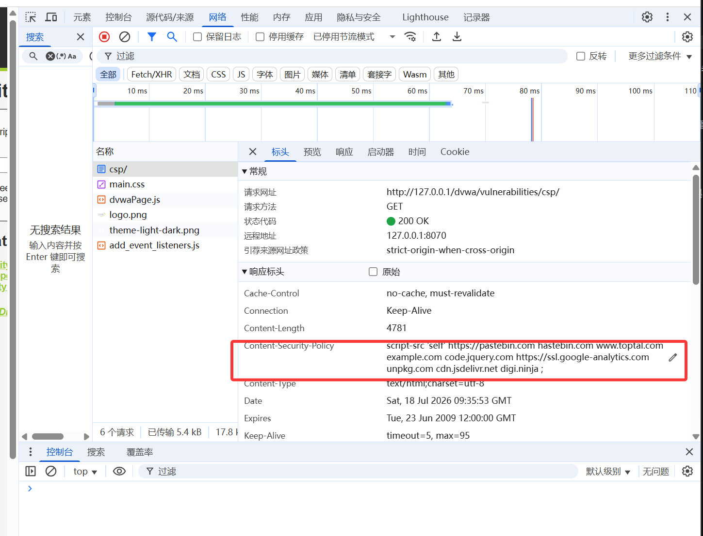
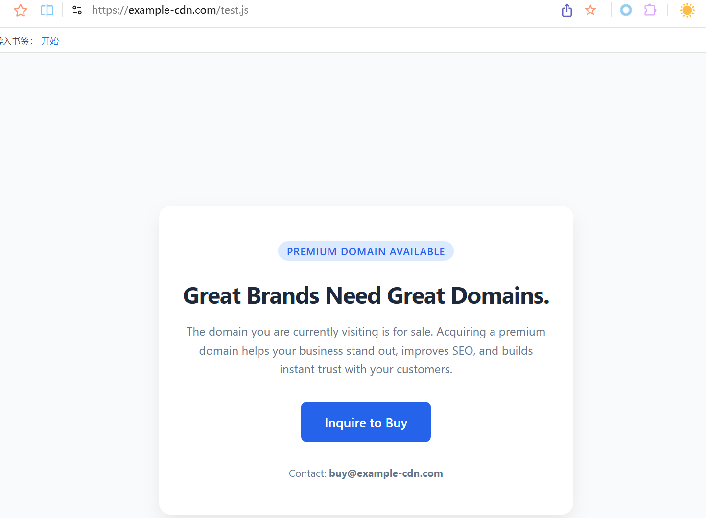
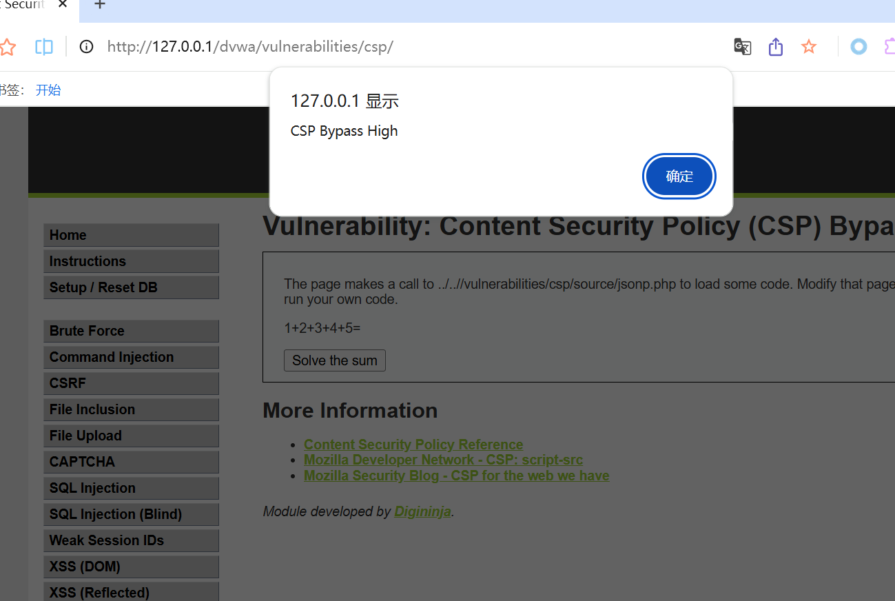

# CSP Bypass

CSP 是浏览器侧的一道防线：响应头里声明"只允许从哪些地方加载脚本"，浏览器照做。写对了能挡掉大部分 XSS，写错了就是摆设。

这个模块练的不是"破 CSP"，是"看配置哪里写歪了"。

## 先认几个指令

| 配置 | 含义 | 常见错误 |
|---|---|---|
| `script-src 'self'` | 只准加载同源脚本 | 同源里有 JSONP、上传、可控 JS 就还能绕 |
| `script-src 'unsafe-inline'` | 允许内联脚本 | 等于放开了 XSS 最常见的形态 |
| `script-src https://cdn.xxx` | 允许指定外域 | 白名单域能托管任意内容就有风险 |
| `nonce-xxx` | 只执行带这个 nonce 的脚本 | nonce 固定不变就等于公开 |
| `strict-dynamic` | 信任合法脚本动态插入的脚本 | 现代方案，但依赖浏览器支持 |

看 CSP 的方法：F12 → Network → 刷新 → 点主文档请求 → Response Headers → 找 `Content-Security-Policy`。

## Low：白名单太宽

Low 的 CSP 允许从一批外部域加载脚本。配置本身没错，问题是允许的域太多，其中有些域用户能往上传文件。

思路很直接：把恶意 JS 放到一个"白名单里允许、但内容我能控制"的域名上，然后让页面去加载它。

```html
<script src="https://被允许的域名/alert.js"></script>
```

如果页面只让填 URL，直接提交那个 JS 的地址。





**这条在本机的复现受环境限制**：DVWA 默认白名单里的域名不归我控制，我没有真的往那些域上传文件。这一级的结论来自官方文档和公开 writeup，我验证到的是"页面确实允许外部域"这一步，最后一步"让页面加载我自己的 JS"没在本机跑通。

判断标准记住一条就够：**白名单里只要有一个域能托管任意用户内容（网盘、图床、paste、代码托管），CSP 就等于没写**。

## Medium：固定 nonce

Medium 用了 nonce，但实现错了：

```
Content-Security-Policy: script-src 'self' 'unsafe-inline' 'nonce-TmV2ZXIgZ29pbmcgdG8gZ2l2ZSB5b3UgdXA='
```

两个问题叠在一起：

1. nonce 是写死的，刷新十次都还是这一串。攻击者看一次页面就知道。
2. 同时带了 `'unsafe-inline'`。有这一项在，内联脚本本来就允许，nonce 完全失去意义。

payload 就是把那个 nonce 抄进 `<script>` 标签：

```html
<script nonce="TmV2ZXIgZ29pbmcgdG8gZ2l2ZSB5b3UgdXA=">alert("CSP Bypass Medium")</script>
```

提交后弹窗。


nonce 的正确用法：每个响应生成一个加密安全随机值，绝不重复，也绝不和 `'unsafe-inline'` 同时出现。

## High：同源 JSONP

High 把 CSP 收紧到 `script-src 'self'`，外部域和内联脚本都禁了。表面看没缝。

但页面里有个功能用 JSONP 取数据：

```html
<script src="source/jsonp.php?callback=solveSum"></script>
```

JSONP 的原理是把 JS 文件当数据用，服务端返回 `solveSum({"answer":15})`，浏览器当代码执行。那个 `callback` 是函数名，如果它由请求参数控制，就等于请求参数直接变成了代码。

Burp 拦下点击"Solve the sum"时的请求：

```
GET /dvwa/vulnerabilities/csp/source/jsonp.php?callback=solveSum HTTP/1.1
```

把 `callback` 改掉：

```
callback=alert("CSP Bypass High")//
```

URL 编码后是 `callback=alert%28%22CSP%20Bypass%20High%22%29%2F%2F`。末尾的 `//` 是用来注释掉服务端自动补的那个括号，不然语法错误。

服务端返回变成 `alert("CSP Bypass High")//({"answer":15});`，浏览器执行前面那段。



为什么 `script-src 'self'` 拦不住：脚本确实来自同源，那个 `jsonp.php` 就在本站。CSP 只判断"资源从哪来"，不判断"内容是什么"。同源接口自己吐出了攻击者控制的代码，CSP 没有理由拦。

## Impossible 为什么打不进去

1. CSP 严格，只有同源
2. 没有 `'unsafe-inline'`，没有固定 nonce
3. JSONP 的 callback 写死在代码里，用户改不了
4. 用户输入不参与 HTML/JS 拼接

第 3 条是关键。JSONP 这个机制本身有风险，但只要 callback 名固定、不接受参数，就注入不进去。更彻底的修法是别用 JSONP，改用 CORS + JSON，数据永远是数据，不会被当代码执行。

## 我卡住的地方

- 一开始以为 CSP 是服务端过滤，改了半天请求没用。后来才明白 CSP 是给浏览器的指令，服务端只是发个头，真正的拦截发生在浏览器里。
- Medium 第一次只改了 payload 的 nonce 值，忘了 nonce 必须是页面上真实存在的那一串。对着 CSP 头抄下来才对。
- High 改 callback 后一直报语法错误，原因是服务端会在 callback 后面直接拼 `({...})`，不注释掉就变成 `alert(...) ({...})`，语法不通。加 `//` 解决。

## 怎么修

1. nonce 每次请求重新生成，用 `random_bytes` 这类真随机源，别用时间戳或者固定串。
2. 不要同时使用 `nonce` 和 `'unsafe-inline'`。浏览器遇到 `'unsafe-inline'` 时会忽略 nonce，等于白配。
3. 白名单只放自己能控制的域，别放任何允许用户上传内容的域名。
4. 淘汰 JSONP。需要跨域就用 CORS，返回 `application/json`，并加 `X-Content-Type-Options: nosniff`。
5. CSP 是兜底，不是主力。输出编码没做好，CSP 配得再严也只是提高门槛。

## 参考来源

Low 和 Impossible 两级的配置描述参考了 DVWA 官方文档和公开 writeup：

- DVWA 官方文档 CSP Bypass 章节
- digininja/DVWA 项目的 CSP 说明页
- braincoke 的 DVWA CSP Bypass writeup

High 的 JSONP 绕过和 Medium 的固定 nonce 是我在本机实际跑通的。
