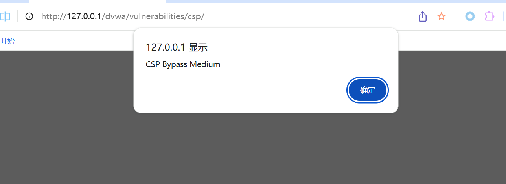

# CSP Bypass

CSP 是响应头里的一条指令，告诉浏览器"只允许从这些地方加载脚本"。写对了能挡掉大部分 XSS，写错了就是摆设。这个模块练的是看配置哪里歪了，不是破 CSP 本身。

## 漏洞在哪

漏洞不在代码里，在响应头。三档各写错一处：

```text
Low     script-src 白名单过宽，允许托管任意内容的域名
Medium  nonce 写死，且与 'unsafe-inline' 同时出现
High    script-src 'self'，但同源存在可控 callback 的 JSONP
```

CSP 只判断资源来源，不判断内容。来源合规而内容是攻击者控制的，一样执行。

## 先认指令

| 配置 | 含义 | 常见错误 |
|---|---|---|
| `script-src 'self'` | 只准同源脚本 | 同源有 JSONP、上传、可控 JS 仍能绕 |
| `script-src 'unsafe-inline'` | 允许内联脚本 | 等于放开 XSS 最常见形态 |
| `script-src https://cdn.x` | 允许指定外域 | 该域能托管任意内容就有风险 |
| `nonce-xxx` | 只执行带此 nonce 的脚本 | nonce 固定即等于公开 |
| `strict-dynamic` | 信任合法脚本动态插入的脚本 | 现代方案，但依赖浏览器支持 |

查看方法：F12 → Network → 刷新 → 主文档请求 → Response Headers → `Content-Security-Policy`。

## 等级对照

| 等级 | CSP 写法 | 绕过 | 状态 |
|---|---|---|---|
| Low | 允许多个外部脚本域 | 从白名单域加载自己的 JS | 未在本机跑通，见参考 |
| Medium | 固定 nonce + `unsafe-inline` | 抄 nonce 构造内联脚本 | 实测成功 |
| High | `script-src 'self'` | JSONP callback 注入 | 实测成功 |
| Impossible | 严格 CSP + callback 硬编码 | 无明显绕法 | 打不进去 |

## Low

| 项 | 内容 |
|---|---|
| 问题 | 白名单过宽，允许多个第三方域 |
| 思路 | 把 JS 放到"白名单允许、内容我可控"的域上 |
| 落地 | `<script src="https://被允许的域/alert.js"></script>` |
| 状态 | 只验证到"页面确实允许外部域"，最后一步未在本机完成 |


判断标准一条就够：**白名单里只要有一个域能托管任意用户内容（网盘、图床、paste、代码托管），CSP 等于没写**。

## Medium

| 项 | 内容 |
|---|---|
| CSP | `script-src 'self' 'unsafe-inline' 'nonce-TmV2ZXIgZ29pbmcgdG8gZ2l2ZSB5b3UgdXA='` |
| 问题一 | nonce 写死，刷新多次不变 |
| 问题二 | 同时带 `unsafe-inline`，内联本来就允许，nonce 失去意义 |
| 绕过 | 把 nonce 抄进自己的 `<script>` 标签 |

```html
<script nonce="TmV2ZXIgZ29pbmcgdG8gZ2l2ZSB5b3UgdXA=">alert("CSP Bypass Medium")</script>
```



nonce 的正确用法：每个响应生成加密安全随机值，绝不重复，绝不与 `unsafe-inline` 同时出现（同时出现时浏览器会忽略 nonce）。

## High

| 项 | 内容 |
|---|---|
| CSP | `script-src 'self'`，外域与内联全禁 |
| 缺口 | 页面用 JSONP 取数，`callback` 参数可控 |
| 绕过 | 抓包把 `callback=solveSum` 改成 `callback=alert(...)//` |
| 原因 | 脚本来自同源，CSP 只看来源不看内容 |

```text
GET /dvwa/vulnerabilities/csp/source/jsonp.php?callback=solveSum HTTP/1.1
→ callback=alert%28%22CSP%20Bypass%20High%22%29%2F%2F
```

服务端返回 `alert("CSP Bypass High")//({"answer":15});`，末尾 `//` 用来注释掉自动补的括号，不加会语法错误。


CSP 判断的是"资源从哪来"，不判断"内容是什么"。同源接口自己吐出了攻击者控制的代码，CSP 没有理由拦。

## Impossible

- CSP 严格，只允许同源
- 没有 `unsafe-inline`，没有固定 nonce
- JSONP 的 callback 名写死在代码里，用户改不了
- 用户输入不参与 HTML/JS 拼接

第 3 条是关键。JSONP 这机制本身有风险，但 callback 固定就注入不进去。更彻底的修法是别用 JSONP，改 CORS + JSON。

## 容易记错的地方

- CSP 不是服务端过滤。改请求没用，拦截发生在浏览器里，服务端只负责发头。
- Medium 的 nonce 必须抄页面上真实的那一串，自己编一个没用。
- High 改完 callback 报语法错误，通常是漏了 `//`，服务端会往后拼 `({...})`。
- 同源不等于安全，同源里也可能有可控输出点。

## 怎么修

| 措施 | 作用 |
|---|---|
| nonce 每请求随机 | 用 `random_bytes` 一类真随机源 |
| 不同时用 nonce 与 `unsafe-inline` | 否则 nonce 被忽略 |
| 白名单只放自己能控制的域 | 尤其别放允许上传的域名 |
| 淘汰 JSONP | 改 CORS + `application/json` + `nosniff` |
| 输出编码 | CSP 是兜底，不是主力 |

## 参考

- Low 与 Impossible 的配置描述参考 DVWA 官方文档与公开 writeup（digininja/DVWA CSP 说明页、braincoke 的 CSP Bypass 记录）。
- Medium 的固定 nonce、High 的 JSONP 注入为本机实测。
