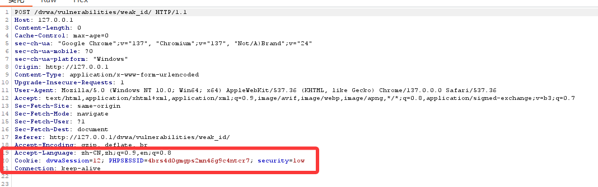
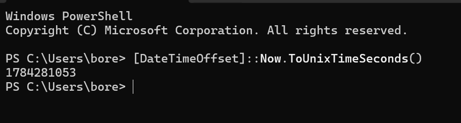
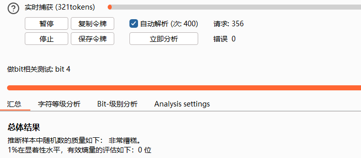
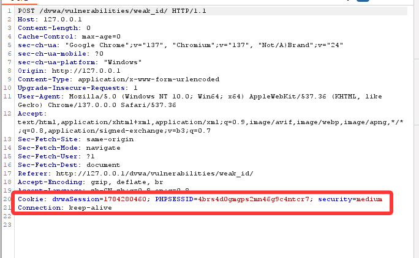
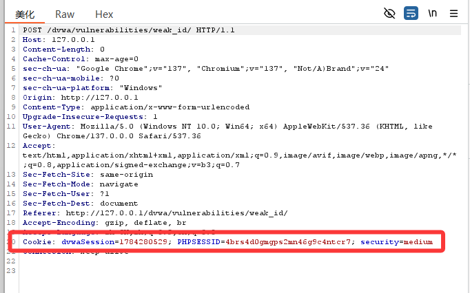
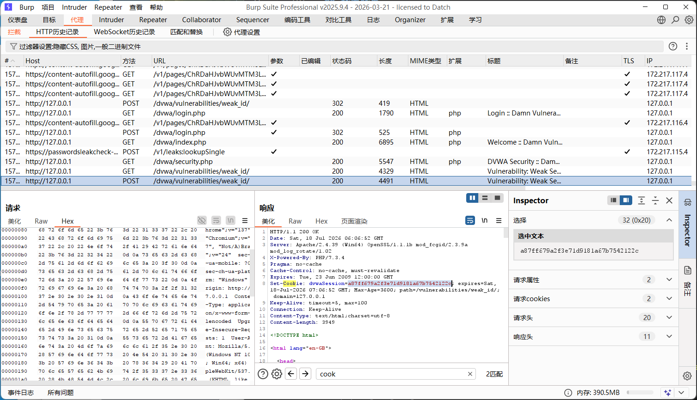

# Weak Sessions IDs

页面有个按钮，点一下服务端就发一个新的 `dvwaSession` Cookie。名字叫"弱会话 ID"，练的是这串值能不能被猜出来。

会话 ID 本该是随机的。如果它可预测，攻击者拿到自己的 ID 就能推别人的，等于不用密码就能顶替登录。

## 怎么看

两种办法，都用得上：

**F12**：Application → Storage → Cookies，点按钮刷新看 `dvwaSession` 的变化。

**Burp**：Proxy → HTTP history，点按钮，看响应头里的 `Set-Cookie: dvwaSession=xxx`。连点几次就能拿到一串。




## Low：自增

点五次得到 1、2、3、4、5。

```php
$_SESSION['last_session_id']++;
$cookie_value = $_SESSION['last_session_id'];
setcookie("dvwaSession", $cookie_value);
```

就是一个计数器。我的值是 10，别人的大概率是 8、9、11、12。写个循环几秒钟就能把所有用户的会话试一遍。

这一级没什么技术含量，但它把"什么是弱随机"讲清楚了：可枚举就等于没有。

## Medium：时间戳

值变成 `1719301234` 这种十位数，看起来比 1、2、3 高级多了。

```php
$cookie_value = time();
setcookie("dvwaSession", $cookie_value);
```

`time()` 返回的是 Unix 时间戳，1970 年到现在过了多少秒。

### 验证它是不是时间戳

拿到 Cookie 的值，再在本地取当前时间戳，比一下：

```bash
date +%s
```

```powershell
[DateTimeOffset]::Now.ToUnixTimeSeconds()
```

两个数差个位数，就说明是时间戳。



### 为什么这也不安全

攻击者知道请求大概发生在什么时候（现在），所以搜索空间只有一个小窗口。前后枚举几十个值就能覆盖。

### Burp Sequencer 看熵

Sequencer 是 Burp 专门分析 token 随机性的模块。

1. 抓到生成 Cookie 的请求
2. 右键 `Send to Sequencer`
3. `Live capture` 里配置从响应中提取 `dvwaSession`
4. 采几百个样本，看分析结果

结果是"随机性极差、熵极低"。这是正常现象：时间戳本来就不是随机数，它是当前时间，当然能被预测。







这个工具值得记住，真实项目里遇到可疑 token 可以先丢进去跑一遍，比自己写统计快。

## High：md5(自增)

值变成 32 位十六进制：

```
c4ca4238a0b923820dcc509a6f75849b
c81e728d9d4c2f636f067f89cc14862c
eccbc87e4b5ce2fe28308fd9f2a7baf3
a87ff679a2f3e71d9181a67b7542122c
```

看着像随机。实际上是 `md5(1)`、`md5(2)`、`md5(3)`、`md5(4)`。

一张彩虹表或者十行 Python 就能反查：

```python
import hashlib
for i in range(1, 1001):
    print(i, hashlib.md5(str(i).encode()).hexdigest())
```

拿观察到的 Cookie 在表里一搜，就知道它是第几号。然后前后推几个，别人的会话就到手了。




这一级的教学点：**哈希不等于随机**。MD5 是单向函数，但它的输入可预测，输出就跟着可预测。对自增数字做 MD5、SHA1、Base64，都只是换了个好看的壳。

## Impossible 为什么打不进去

```php
// 示意写法，不同 DVWA 版本的具体实现有差异，
// 关键是"密码学安全随机数"这一条，不是函数名
$cookie_value = bin2hex(random_bytes(32));
setcookie("dvwaSession", $cookie_value, [
    'expires'  => time() + 3600,
    'path'     => '/vulnerabilities/weak_id/',
    'secure'   => true,
    'httponly' => true,
    'samesite' => 'Strict'
]);
```

两个关键点：`random_bytes(32)` 是密码学安全随机源，不是伪随机也不是时间；32 字节转十六进制是 64 位字符，搜索空间大到不可能枚举。

Cookie 的几个属性也一起配上了：

| 属性 | 作用 |
|---|---|
| `HttpOnly` | JS 读不到，XSS 偷不走 |
| `Secure` | 只走 HTTPS，明文网络里抓不到 |
| `SameSite` | 跨站请求不带，缓解 CSRF |
| `Path` | 限定作用路径 |
| `Expires` | 控制生命周期 |

## 我卡住的地方

- Medium 一开始没看出规律，因为十位数不像 1、2、3 那么直白。试了一下 `date +%s` 才发现差 3 秒，就是时间戳。
- Sequencer 第一次配置提取规则失败，原因是选错了响应包（选到了 302 那个）。必须选真正带 `Set-Cookie` 的 200 响应。
- High 用 Python 反查的时候，一开始只算了 md5 的前几位对比，对不上。MD5 是 32 位全串比较，少一位都不算。

## 怎么修

1. 会话 ID 用 CSPRNG 生成。PHP 用 `random_bytes()`，Java 用 `SecureRandom`，别用 `rand()`、`mt_rand()`、`time()`。
2. 长度够。至少 128 位熵，实际用 32 字节。
3. 登录成功后重新生成会话 ID，防会话固定。
4. Cookie 加 `HttpOnly`、`Secure`、`SameSite`。
5. 服务端做会话校验：IP 或 UA 突变时要求重新登录，别只靠 ID 认人。
