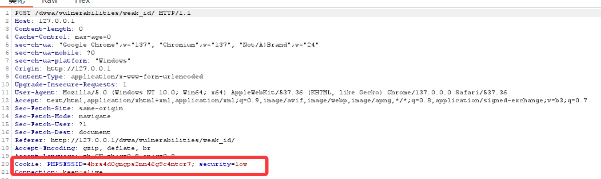
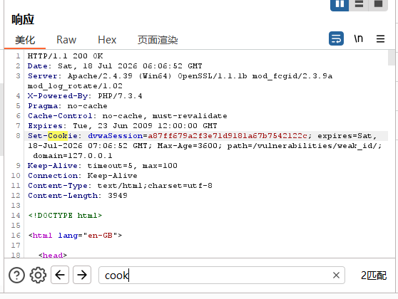
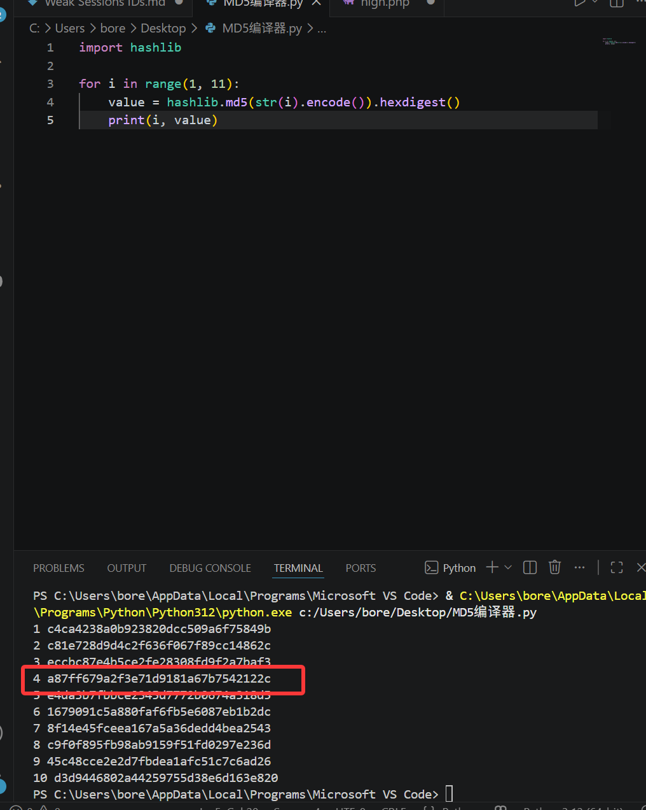

# Weak Sessions IDs

点一下按钮，服务端发一个新的 `dvwaSession` Cookie。模块练的是这串值能不能被猜。会话 ID 本该随机，一旦可预测，拿到自己的就能推别人的，等于不用密码就能顶替登录。

## 漏洞在哪

```php
$_SESSION['last_session_id']++;
setcookie("dvwaSession", $_SESSION['last_session_id']);
```

用来认人的那串值，生成依据是计数器。四档的差别只在生成依据换了几次：计数、时间、哈希后的计数。

## 怎么看

| 方式 | 路径 |
|---|---|
| 浏览器 | F12 → Application → Storage → Cookies，点按钮看变化 |
| Burp | Proxy → HTTP history，看响应头 `Set-Cookie: dvwaSession=xxx` |

连点几次拿到一串值，规律一眼就能看出来。




## 等级对照

| 等级 | 生成方式 | 本机结果 |
|---|---|---|
| Low | 自增整数 | 可枚举，直接推 |
| Medium | `time()` 时间戳 | 按时间窗口枚举几十个值 |
| High | `md5(自增整数)` | 预先算表反查 |
| Impossible | 密码学安全随机数 | 打不进去 |

## Low

| 项 | 内容 |
|---|---|
| 值 | `dvwaSession=1`、`2`、`3`、`4`、`5` |
| 逻辑 | `$_SESSION['last_session_id']++` |
| 攻击 | 我的值是 10，别人的在 8、9、11、12 附近 |
| 结论 | 可枚举等于没有随机性 |

这一级没技术含量，但它把"什么是弱随机"讲清楚了。

## Medium

| 项 | 内容 |
|---|---|
| 值 | `1719301234` 这类十位数 |
| 逻辑 | `$cookie_value = time();` |
| 判断 | 与本地当前时间戳比较，差个位数就是时间戳 |
| 空间 | 只知道大致时间，前后枚举几十个值即覆盖 |

```bash
date +%s
```

```powershell
[DateTimeOffset]::Now.ToUnixTimeSeconds()
```


Burp Sequencer 可以直接看出随机性有多差：

| 步骤 | 动作 |
|---|---|
| 1 | 抓到生成 Cookie 的请求，右键 Send to Sequencer |
| 2 | `Live capture` 配置从响应提取 `dvwaSession` |
| 3 | 采几百个样本看分析结果 |

结果是熵极低、重复率高。这是正常现象：时间戳本来就不是随机数，它是当前时间。


这个工具值得记住，真实项目遇到可疑 token 先丢进去跑一遍，比自己写统计快。

## High

| 项 | 内容 |
|---|---|
| 值 | `c4ca4238a0b923820dcc509a6f75849b` 这类 32 位串 |
| 真相 | 分别是 `md5(1)`、`md5(2)`、`md5(3)`、`md5(4)` |
| 反查 | 十行 Python 生成 1 到 1000 的表，搜到即知序号 |
| 结论 | 哈希不等于随机，输入可预测则输出可预测 |

```python
import hashlib
for i in range(1, 1001):
    print(i, hashlib.md5(str(i).encode()).hexdigest())
```






## Impossible

```php
// 示意写法，不同版本实现不同，关键是密码学安全随机数这一条
$cookie_value = bin2hex(random_bytes(32));
setcookie("dvwaSession", $cookie_value, [
    'expires'=>time()+3600, 'path'=>'/vulnerabilities/weak_id/',
    'secure'=>true, 'httponly'=>true, 'samesite'=>'Strict'
]);
```

`random_bytes` 是真随机源，32 字节转十六进制是 64 字符，搜索空间大到不可能枚举。

| Cookie 属性 | 作用 |
|---|---|
| `HttpOnly` | JS 读不到，XSS 偷不走 |
| `Secure` | 只走 HTTPS |
| `SameSite` | 跨站不带，缓解 CSRF |
| `Path` | 限定作用路径 |
| `Expires` | 控制生命周期 |

## 容易记错的地方

- Medium 的十位数不像 1、2、3 直白，得实际取一次时间戳对比才认得出。
- Sequencer 提取规则配错多半是选错了响应包，必须选带 `Set-Cookie` 的 200。
- md5 反查要 32 位全串比较，只比前几位对不上。
- 看起来复杂的数字不等于安全，High 就是给自增套了个壳。

## 怎么修

| 措施 | 作用 |
|---|---|
| CSPRNG 生成 | `random_bytes()`、`SecureRandom`，不用 `rand()`、`time()` |
| 长度足够 | 至少 128 位熵，实际用 32 字节 |
| 登录后重新生成 | 防会话固定 |
| Cookie 加三属性 | `HttpOnly`、`Secure`、`SameSite` |
| 会话校验 | IP 或 UA 突变要求重登 |
