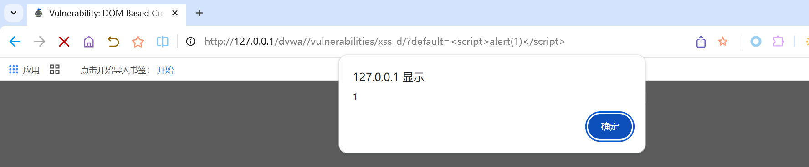
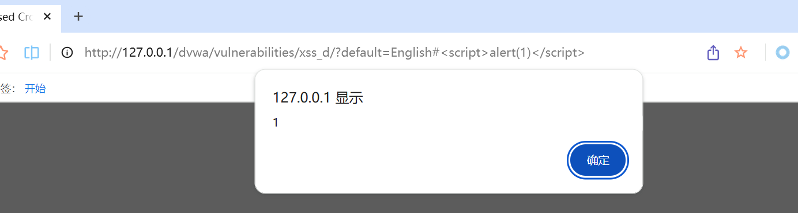

# XSS(DOM)

页面让选语言，参数是 `?default=English`。前端 JS 拿这个参数拼进页面，PHP 一行都没写。

这带来了一个很实际的后果：**看流量看不到 payload**。因为取参数、写 DOM 全在浏览器里发生，服务器只看到 `?default=English` 干干净净的一个词。

## source 和 sink

DOM 型 XSS 就是"从一个可控的地方取值（source），塞进一个危险的地方（sink）"。

常见的 source：

```
location.href      location.search      location.hash
document.URL       document.referrer    window.name
localStorage       sessionStorage       document.cookie
```

常见的 sink：

```
document.write()      element.innerHTML    element.outerHTML
insertAdjacentHTML()  eval()               setTimeout("code")
Function()            setInterval("code")
```

只要有一条链子把 source 接到 sink 上，中间又没有处理，就是 DOM XSS。审计前端代码的时候就是找这个连线。

## Low

DVWA 的实现大概是 `document.write(location.hash.substring(1))` 或者从 `?default` 取。

```
?default=<script>alert(1)</script>
```

弹窗。



## hash 的特殊性

URL 里 `#` 后面的部分叫 fragment，这一段的规则很特殊：

- **不发送给服务器**。服务器看到的只有 `?default=English`。
- 前端的 `location.href` **包含**这一段。

```
http://127.0.0.1/dvwa/vulnerabilities/xss_d/?default=English#<script>alert(1)</script>
```

后端眼里：`default=English`，合法。
前端从 `location.href` 取值时：把 `#<script>...` 一起取走了。

这个错位是 High 能过的全部原因。

## Medium

加了黑名单，把 `<script` 过滤掉。

```
?default=<script>alert(1)</script>     → 被拦
```

换事件属性：

```
?default=<svg onload=alert(1)>
?default=
```

都能过。


同一个错，第四次出现了：**黑名单写在标签名上，等于写在错的地方**。

## High

后端改成白名单，只允许 `default` 取几个固定值（English、French、German、Spanish），其他值直接重定向走。

```
?default=<script>alert(1)</script>     → 被重定向，白名单生效
```

看起来堵住了。但白名单检查的是 **query 参数**，而前端读取的是 **完整 URL**：

```
?default=English#<script>alert(1)</script>
```

后端收到的 `default` 是 `English`，白名单通过。前端 `location.href` 把 hash 也带上了，payload 就从缝里进去了。



这一条最值得记：**后端校验的数据范围，和前端实际使用的数据范围不一致**，中间那段差值就是攻击面。类似的问题还有：后端只校验 POST 参数但前端从 Cookie 取、后端校验了原始值但前端做了 `decodeURIComponent`。

## Impossible 为什么打不进去

1. 后端严格白名单
2. 前端不再用 `document.write` 之类的危险 sink，改成从固定映射表里取值
3. 页面结构由服务端确定，用户输入不参与 HTML 拼接

根子在第二条：**换掉了 sink**。只要不把用户数据往 `innerHTML`、`document.write` 里塞，source 再脏也没用。

## 我卡住的地方

- 最初一直在 Burp 里找 payload，找不到。后来才想明白 hash 根本不出浏览器，看流量看不到东西。这类漏洞得开 F12 看 DOM 和 Console。
- High 试了很久的 `?default=<script>`，全被重定向。看到"后端只校验 query"这个提示才想到 hash。
- 一开始以为 `#` 后面的东西也会被 URL 编码发送，实测抓包确认了：请求行里根本没有 `#` 之后的部分。

## 怎么修

1. 不用危险的 sink。要插文本用 `textContent`，不要用 `innerHTML`。
2. 必须插 HTML 的时候，先做白名单净化（DOMPurify 这类库）。
3. 不要从 `location.href` 直接取值拼 DOM。取参数用 `URLSearchParams`，只取需要的那一个。
4. 后端白名单要有，但别指望它能管住前端取值的范围。
5. CSP 限制脚本执行，作为兜底。
