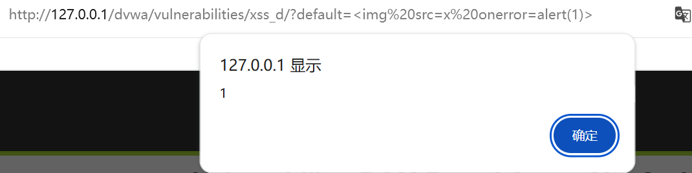

# XSS(DOM)

页面让选语言，参数是 `?default=English`。前端 JS 取这个参数拼进页面，PHP 一行没写。

后果很实际：**看流量看不到 payload**。取值和写 DOM 都在浏览器里发生，服务器只收到 `?default=English` 这个干净的词。

## 漏洞在哪

```javascript
var lang = document.location.href.substring(...);
document.write("<option value='" + lang + "'>" + lang + "</option>");
```

用户可控的值从 `location` 取出，直接进 `document.write`，中间没有处理。

## source 与 sink

DOM 型就是"从可控的地方取值（source），塞进危险的地方（sink）"。

| 类别 | 常见项 |
|---|---|
| source | `location.href`、`location.search`、`location.hash`、`document.URL`、`document.referrer`、`localStorage`、`document.cookie` |
| sink | `document.write()`、`innerHTML`、`outerHTML`、`insertAdjacentHTML()`、`eval()`、`setTimeout("code")`、`Function()` |

审计前端时就是找这条连线：source 接到 sink，中间没过编码。

## 等级对照

| 等级 | 防护 | 本机结果 |
|---|---|---|
| Low | 无 | `<script>` 直接执行 |
| Medium | 黑名单过滤 `<script>` | `<svg onload>`、`` 绕过 |
| High | 后端白名单限定 query 值 | hash 段绕过 |
| Impossible | 换掉危险 sink | 打不进去 |

## Low

| 项 | 内容 |
|---|---|
| Payload | `?default=<script>alert(1)</script>` |
| 结果 | 弹窗 |
| 原因 | 取到的值直接写进 DOM |


## hash 的特殊性

URL 里 `#` 后面叫 fragment，规则和别人不一样：

| 特性 | 说明 |
|---|---|
| 是否发送给服务器 | 不发送。服务器只看到 `?default=English` |
| 前端能否读到 | `location.href` 包含这一段 |

```text
http://127.0.0.1/dvwa/vulnerabilities/xss_d/?default=English#<script>alert(1)</script>
```

后端眼里 `default=English` 合法，前端从 `location.href` 取值时把 `#` 后面一起拿走。这个错位就是 High 能过的全部原因。

## Medium

| 项 | 内容 |
|---|---|
| 防护 | 黑名单过滤 `<script>` |
| 绕过 | `<svg onload=alert(1)>`、`` |
| 原因 | 只过滤一个标签，事件属性没管 |

同一个错在这个靶场出现第四次：黑名单写在标签名上，等于写在错的地方。



## High

| 项 | 内容 |
|---|---|
| 防护 | 后端白名单，`default` 只允许 English/French/German/Spanish |
| 直接打 | `?default=<script>` 被重定向 |
| 绕过 | `?default=English#<script>alert(1)</script>` |
| 原因 | 后端只校验 query，前端读的是完整 URL |


这一条最值得记：**后端校验的数据范围，和前端实际使用的数据范围不一致，中间的差值就是攻击面**。同类问题还有：后端校验 POST 但前端从 Cookie 取、后端校验原始值但前端先 `decodeURIComponent`。

## Impossible

```javascript
var lang = document.getElementById('default').value;   // 只能取固定选项的值
document.body.appendChild(document.createTextNode(lang));
```

根子在换掉 sink。不把用户数据往 `innerHTML`、`document.write` 里塞，source 再脏也没用。

## 容易记错的地方

- 在 Burp 里找 payload 找不到，因为 hash 不出浏览器，这类漏洞要看 F12 的 DOM 与 Console。
- 抓包确认过：请求行里没有 `#` 之后的部分，这个结论要自己验一次才信。
- `location.href`、`location.search`、`location.hash` 三者范围不同，选错就取不到目标值。
- 后端白名单通过不代表前端安全，两者看的数据不是一份。

## 怎么修

| 措施 | 作用 |
|---|---|
| 不用危险 sink | 插文本用 `textContent`，不用 `innerHTML` |
| 必须插 HTML 时先净化 | DOMPurify 这类白名单库 |
| 取参数用 `URLSearchParams` | 只取需要的那一个，不带 hash |
| 前端不从完整 URL 拼 DOM | 从固定映射表取值 |
| CSP 兜底 | 限制脚本执行 |
