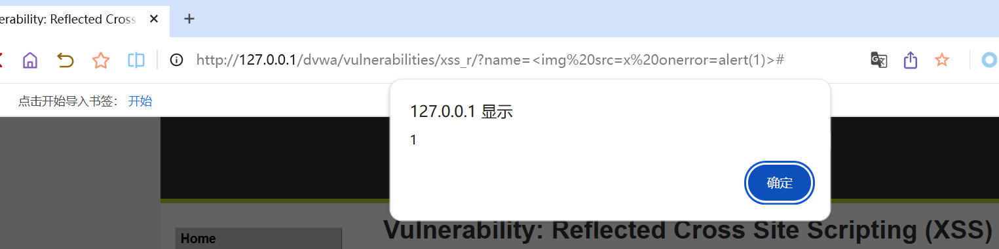
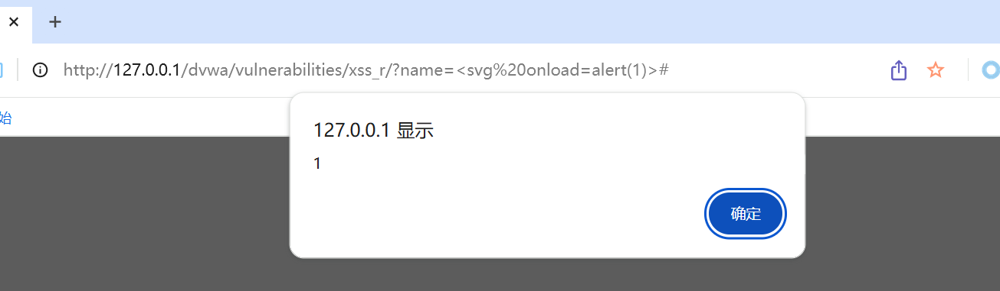

# XSS(Reflected)

输入框填名字，页面回一句 `Hello 名字`。输入原样进 HTML，浏览器按标签解析，脚本就执行了。反射型是一次性的，payload 在 URL 里，同一次响应就带回来，不落库。

## 漏洞在哪

```php
$name = $_GET['name'];
echo "<pre>Hello " . $name . "</pre>";
```

没有编码，没有过滤。用户输入直接成为 HTML 的一部分。

## 等级对照

| 等级 | 防护 | 本机结果 |
|---|---|---|
| Low | 无 | `<script>alert(1)</script>` 执行 |
| Medium | `str_replace` 删 `<script>` | 事件属性、大小写、标签嵌套三种绕过 |
| High | 正则过滤 script，大小写不敏感 | ``、`<svg onload>` 仍执行 |
| Impossible | `htmlspecialchars` 编码 | 打不进去 |

## 输出位置决定编码方式

同一个 payload 放在不同位置，需要的编码不一样，这一层最容易被漏掉。

| 输出位置 | 示例 | 正确做法 |
|---|---|---|
| HTML 正文 | `<div>输入</div>` | HTML 实体编码 |
| HTML 属性 | `<input value="输入">` | 属性编码，值加引号 |
| JS 字符串 | `var a = "输入"` | JS 转义，不拼字符串 |
| URL 参数 | `<a href="输入">` | URL 编码 + 协议白名单 |

## Low

| 项 | 内容 |
|---|---|
| Payload | `<script>alert(1)</script>` |
| 结果 | 弹窗 |
| 原因 | 无过滤，输入直接进 HTML |

```
?name=<script>alert(1)</script>
```


## Medium

| 项 | 内容 |
|---|---|
| 防护 | `str_replace('<script>', '', $name)` |
| 绕过一 | `` |
| 绕过二 | `<svg onload=alert(1)>` |
| 绕过三 | `<ScRiPt>alert(1)</ScRiPt>` |
| 绕过四 | `<scr<script>ipt>alert(1)</scr</script>ipt>` |

前两种最省事。服务器只盯着 `script` 这个词，没想到图片和 SVG 也带事件。



## High

| 项 | 内容 |
|---|---|
| 防护 | `preg_replace('/<(.*)s(.*)c(.*)r(.*)i(.*)p(.*)t/i', '', $name)` |
| 失效 | `<ScRiPt>` 与嵌套写法都被拦 |
| 仍可用 | ``、`<svg onload=alert(1)>` |

正则写得再复杂也没用，它解决的是"哪些标签危险"，而这个问题没有穷尽答案。能执行 JS 的标签远不止 `script`。



## Impossible

```php
$name = htmlspecialchars($_GET['name'], ENT_QUOTES, 'UTF-8');
```

三个参数都要给：

| 参数 | 原因 |
|---|---|
| `ENT_QUOTES` | 单双引号都转。默认只转双引号，单引号包属性时会漏 |
| `'UTF-8'` | 不指定字符集在某些编码下可被绕过 |
| 输出位置 | 只在 HTML 正文或属性有效，输出在 `<script>` 里要换 JSON 编码 |

## 会触发的事件属性

| 事件 | 触发时机 |
|---|---|
| `onerror` | 资源加载失败，最常用 |
| `onload` | 元素加载完成 |
| `onclick` | 点击 |
| `onmouseover` | 鼠标移入 |
| `onfocus` | 获得焦点，配合 `autofocus` 可自动触发 |
| `onchange` | 表单值变化 |

## 容易记错的地方

- `<script >` 带空格不是绕过，`str_replace` 匹配完整字符串，浏览器也认不出这个标签。
- `autofocus` 只对表单控件生效，`` 上加不触发，该用 `onerror`。
- 不加 `ENT_QUOTES` 在单引号包属性的场景确实留口子，这个口子很小但真实。
- 黑名单在 Low、Medium、High 三级被验证了三次，都不成立。

## 怎么修

| 措施 | 作用 |
|---|---|
| 按上下文输出编码 | `htmlspecialchars($s, ENT_QUOTES, 'UTF-8')`、`json_encode`、`urlencode` |
| 不用黑名单 | 三级验证已表明不可靠 |
| CSP `script-src 'self'` + nonce | 兜底，有漏点也执行不了 |
| Cookie 加 `HttpOnly` | 脚本读不到 session |
| 富文本用白名单库 | 别自己写正则 |
