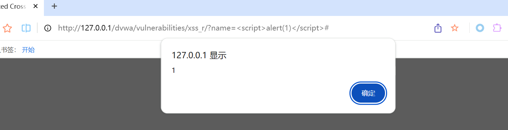

# XSS(Reflected)

输入框里输名字，页面回一句 `Hello 名字`。输入原样进 HTML，浏览器把它解析成标签，就执行了。

反射型的特点是"一次性"：payload 在 URL 里，服务器同一次响应就带回来，不落库。要靠人点链接。

## 先说清楚三种 XSS 的分界

练完三个模块才真正分清：

| 类型 | 数据流向 | 是否落库 | 怎么触发 |
|---|---|---|---|
| 反射型 | 请求参数 → 同次响应 | 否 | 诱导点链接 |
| 存储型 | 提交 → 数据库 → 别人访问 | 是 | 打开页面就行 |
| DOM 型 | URL → 前端 JS → DOM | 否 | 诱导点链接，payload 可能不发到服务器 |

## 输出位置决定防线

同一个 payload 放在不同上下文里，编码方式不一样。这是 XSS 最容易被忽略的一层。

| 输出位置 | 例子 | 正确做法 |
|---|---|---|
| HTML 正文 | `<div>输入</div>` | HTML 实体编码 |
| HTML 属性 | `<input value="输入">` | 属性编码，值必须加引号 |
| JS 字符串 | `var a = "输入"` | JS 转义，别直接拼 |
| URL 参数 | `<a href="输入">` | URL 编码 + 协议白名单 |

## Low

一行过滤都没有：`echo "<pre>Hello " . $_GET['name'] . "</pre>";`

```
?name=<script>alert(1)</script>
```

弹窗。



## Medium

`str_replace` 把 `<script>` 删掉。

黑名单一旦固定，绕过就有清单可背：

| 绕过思路 | payload |
|---|---|
| 换标签，用事件属性 | `` |
| SVG 也能带事件 | `<svg onload=alert(1)>` |
| 大小写 | `<ScRiPt>alert(1)</ScRiPt>` |
| 标签嵌套 | `<scr<script>ipt>alert(1)</scr</script>ipt>` |

四种都过了。前两种最省事，因为服务器只盯着 `script` 这个单词，没想到图片和 SVG 也有 `onerror`、`onload`。


## High

换成正则，大小写不敏感，试图连变形一起拦：

```php
$name = preg_replace('/<(.*)s(.*)c(.*)r(.*)i(.*)p(.*)t/i', '', $_GET['name']);
```

这一版把大小写和嵌套都堵了，`<ScRiPt>` 和 `<scr<script>ipt>` 都失败。但 `script` 本来就不是唯一的执行入口：

```
      → 成功
<svg onload=alert(1)>             → 成功
```


正则写得再复杂也没用，因为它解决的是"哪些标签危险"，而这个问题没有穷尽答案。浏览器能执行 JS 的地方太多了，``、`<svg>`、`<body>`、`<input>`、`<details>`、`<marquee>` 全都有事件属性。

## Impossible 为什么打不进去

```php
$name = htmlspecialchars($_GET['name'], ENT_QUOTES, 'UTF-8');
echo "<pre>Hello {$name}</pre>";
```

`htmlspecialchars` 把 `<`、`>`、`"`、`'`、`&` 换成实体。浏览器看到 `&lt;script&gt;` 就只当普通文字显示，不会当标签解析。

三个参数都得给：

- `ENT_QUOTES`：单双引号都转。默认只转双引号，属性用单引号包的时候会漏。
- `'UTF-8'`：不指定字符集在某些编码下可被绕过（宽字节那类问题）。
- 输出的位置要是 HTML 正文或属性。如果输出在 `<script>` 里面，`htmlspecialchars` 不管用，得换成 JSON 编码。

## 一个补充：哪些属性会触发

| 事件 | 触发时机 |
|---|---|
| `onclick` | 点击 |
| `onmouseover` | 鼠标移上去 |
| `onload` | 元素加载完 |
| `onerror` | 资源加载失败 |
| `onfocus` | 拿到焦点（配合 `autofocus` 可以自动触发） |
| `onchange` | 表单值变化 |

`onerror` 是最常用的一个，因为只要 `src` 指一个不存在的资源，浏览器必然会报错。

## 我卡住的地方

- Medium 第一次试 `<script >alert(1)</script>`，带个空格以为能过，其实 `str_replace` 匹配的是完整字符串 `<script>`，加空格反而不匹配了……但浏览器也认不出来，所以不是绕过而是直接失败。真正的绕过是换标签。
- High 试了 `onfocus` 加 `autofocus`，页面没反应。原因是那个元素不是表单控件，`autofocus` 不生效。换成 `onerror` 立刻就过。
- 编码这部分一开始以为 `htmlspecialchars` 不加 `ENT_QUOTES` 也没事，直到遇到单引号包属性的场景，才发现这里确实留了口子。

## 怎么修

1. 输出编码，按上下文选编码器。HTML 正文用 `htmlspecialchars($s, ENT_QUOTES, 'UTF-8')`，JS 里用 `json_encode`，URL 里用 `urlencode`。
2. 别用黑名单过滤。这条在四个等级里被验证了三次：Low 没有过滤能打，Medium 删关键字能绕，High 正则还能绕。
3. CSP 兜底。`script-src 'self'` 加 nonce，就算有漏点也执行不了。
4. Cookie 加 `HttpOnly`，XSS 拿不到 session，危害降一个量级。
5. 富文本场景别自己写过滤，用成熟的白名单库（HTMLPurifier 这类）。
