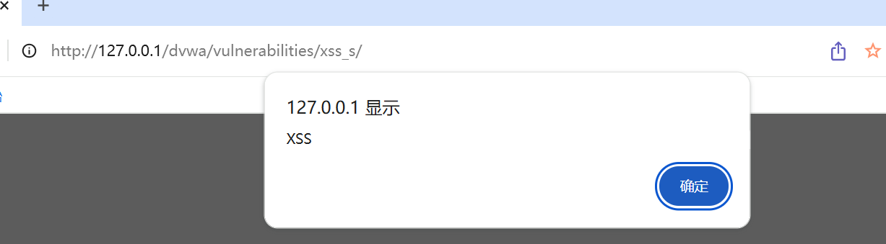
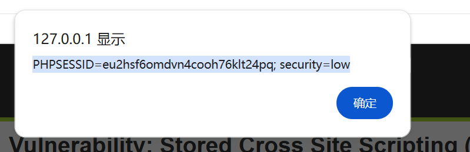
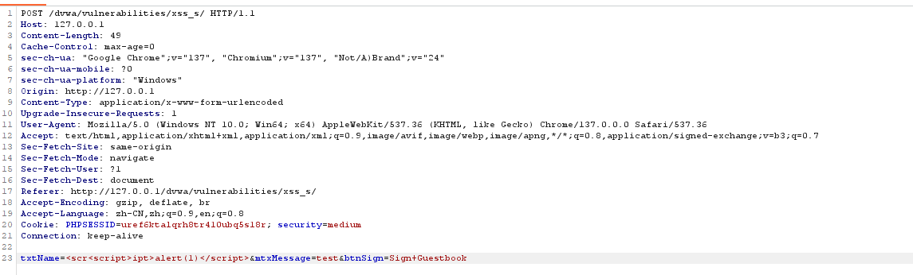
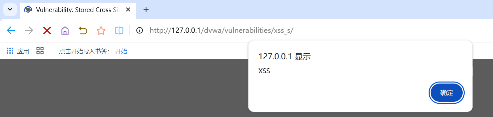

# XSS(Stored)

留言板。填名字和内容，提交后存进数据库，每次打开页面都从库里读出来显示。

区别就在这个"存"字上。payload 进了库，谁访问谁中招，不用点链接，也不用诱导。所以存储型是三种 XSS 里危害最大的。

## 数据流

```
提交内容 → 写入数据库 → 其他用户打开页面 → 从库里读出 → 拼进 HTML → 浏览器执行
```

要注意存储点和触发点不一定在同一个页面。真实环境里更常见的形态是：用户在个人资料里填昵称，昵称存库，**管理员在后台的用户列表页看到它**，XSS 在管理员浏览器里炸。目标不是填内容的用户，是看他内容的人。

## Low

不过滤，直接存，直接输出。

留言内容填：

```html
<script>alert('XSS')</script>
```

提交，页面刷新就弹窗。再刷新一次还弹，因为脚本在库里。



### 读 Cookie

```html
<script>alert(document.cookie)</script>
```

弹出来的就是当前会话的 `PHPSESSID` 和 `security`。真实环境里这一步是把 Cookie 发到攻击者服务器，然后拿这个 Cookie 顶替受害者登录。



### 改页面

```html
<script>document.body.innerHTML='页面已被修改'</script>
```


这条说明危害不止偷 Cookie：钓鱼表单、伪造公告、诱导点击，都是在受害者看起来"正常"的页面上完成的。

## Medium

内容字段做了 `str_replace('<script>', '', $message)`，`<script>` 会被删掉。名字字段也一样处理。

直接 `<script>alert('XSS')</script>` 不弹了。

绕法还是那几个，但这里有个坑：**绕过的 payload 要放进 name 字段，不能放 message**。放 message 会被处理掉，而 name 字段的处理路径不一样。

还有一个更实际的障碍：name 输入框有 `maxlength="10"`，`` 有 28 个字符，页面上根本输不进去。

### 绕 maxlength

三种做法，我用的第一种：

1. Burp 拦下提交请求，直接把 `txtName` 的值改成完整 payload。前端限制只在浏览器里生效，请求体里没有长度约束。
2. `curl` 构造同样的 POST 请求直接发。
3. 控制台里 `document.querySelector('[name=txtName]').removeAttribute('maxlength')`，然后正常输入。



这里有个取舍：第三种最快，但它是在改靶场页面本身，等于绕过了练习对象。前两种才是真实场景里的做法，因为攻击者根本不用你的页面，他自己构造请求。

改完之后的 payload：

```html

<svg onload=alert('XSS')>
<ScRiPt>alert('XSS')</ScRiPt>
```



`<ScRiPt>` 能过是因为 `str_replace` 是区分大小写的，`<script>` 不等于 `<ScRiPt>`。

## High

换成大小写不敏感的正则：

```php
preg_replace('/<(.*)s(.*)c(.*)r(.*)i(.*)p(.*)t/i', '', $message);
```

`script` 的三种写法全废。但事件属性这条路一直开着：

```html

<svg onload=alert('XSS')>
```

和反射型那节完全一样的原因：过滤的是"标签名"，而执行 JS 不靠标签名。

## Impossible 为什么打不进去

两层：

1. 存的时候用 `htmlspecialchars($message, ENT_QUOTES, 'UTF-8')` 编码
2. 输出的时候再编码一次

存进去的已经是实体，`&lt;script&gt;`，读出来显示也是实体，浏览器当文字看。

另外还加了 token 防 CSRF、数据库用预处理语句。这几条和 XSS 没直接关系，但一起构成了这个模块的整体防护。

## 输入过滤和输出编码不是一回事

这个区分很多人搞不清，写在这儿：

| 做法 | 代码 | 效果 |
|---|---|---|
| 输入过滤 | `str_replace('<script>', '', $m)` | 改的是存进库的内容，黑名单可绕 |
| 输出编码 | `htmlspecialchars($m, ENT_QUOTES, 'UTF-8')` | 改的是显示形式，标签变文字，绕不了 |

关键差别：输入过滤要在**入库前**做，一旦漏了，脏数据永远在库里；输出编码在**显示前**做，每个输出点各自处理，漏一个点才漏一个点。

正确做法是输出编码，输入侧只做长度和类型校验，别指望它防 XSS。

## 我卡住的地方

- Medium 一开始把 payload 放 message，怎么都不弹。后来发现 name 字段才是没被处理干净的那个。
- `maxlength` 卡了很久。试过在输入框里粘贴，粘贴也被截断。最后用 Burp 改请求体，一次就过。这件事让我记住了：**所有前端限制都只是体验，不是安全边界**。
- `<ScRiPt>` 大小写绕过的原理是 `str_replace` 区分大小写，不是浏览器不区分。浏览器对标签名是不区分大小写的，所以它会正常解析。

## 怎么修

1. 输出编码，`htmlspecialchars($s, ENT_QUOTES, 'UTF-8')`，每个输出点都要做。
2. 富文本用白名单库，不要自己写正则。
3. Cookie 加 `HttpOnly`，脚本读不到 session。
4. CSP 限制脚本来源。
5. 后台管理页面尤其注意。存储型的触发点经常在后台，管理员一登录就中招，等于直接拿下最高权限。
