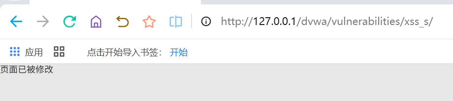

# XSS(Stored)

留言板。填的内容进数据库，每次打开页面都读出来显示。payload 一旦入库，谁访问谁中招，不用点链接，也不用诱导。三种 XSS 里危害最大的一种。

## 漏洞在哪

```php
$message = $_POST['mtxMessage'];
// 直接写库，读出时直接拼进 HTML
echo "<div>{$message}</div>";
```

存的环节不过滤，输出的环节不编码。任意一处做了正确编码，危害都能降到最低。

## 数据流

```text
提交内容 → 写入数据库 → 用户打开页面 → 读出 → 拼进 HTML → 浏览器执行
```

存储点和触发点常常不在同一个页面。真实环境里常见形态是：用户在个人资料里填昵称，昵称存库，管理员在后台用户列表页看到它，XSS 在管理员浏览器里触发。目标不是填内容的人，是看他内容的人。

## 等级对照

| 等级 | 防护 | 本机结果 |
|---|---|---|
| Low | 无 | 弹窗、读 Cookie、改页面均成功 |
| Medium | `str_replace` 删 `<script>`，name 字段有 maxlength | Burp 改请求体绕过 |
| High | 大小写不敏感正则过滤 script | 事件属性仍执行 |
| Impossible | 入库与输出双重编码 | 打不进去 |

## Low

| 项 | 内容 |
|---|---|
| Payload | `<script>alert('XSS')</script>` 放 message |
| 结果 | 提交后弹窗，刷新仍弹 |
| 原因 | 内容原样存库，原样输出 |

```html
<script>alert(document.cookie)</script>
<script>document.body.innerHTML='页面已被修改'</script>
```

第一条弹出 `PHPSESSID` 与 `security`，真实环境是把 Cookie 发到攻击者服务器再顶替登录。第二条说明危害不止偷凭证，钓鱼表单、伪造公告都在这个能力范围内。




## Medium

| 项 | 内容 |
|---|---|
| 防护 | `str_replace('<script>', '', $message)` |
| 卡点 | name 字段 `maxlength="10"`，长 payload 输不进去 |
| 绕过 | Burp 改请求体里的 `txtName` |
| Payload 位置 | 必须放 name，放 message 会被处理掉 |

```html

<svg onload=alert('XSS')>
<ScRiPt>alert('XSS')</ScRiPt>
```

三条绕 maxlength 的路子：

| 做法 | 命令 | 说明 |
|---|---|---|
| Burp 改请求 | 拦 POST，改 `txtName` 值 | 最贴近真实攻击 |
| curl 构造 | 自己拼同样的 POST | 效果相同 |
| 控制台删属性 | `removeAttribute('maxlength')` | 最快，但等于改靶场本身 |

前两种才是真实场景的做法，因为攻击者根本不打开你的页面，他自己构造请求。


## High

| 项 | 内容 |
|---|---|
| 防护 | `preg_replace('/<(.*)s(.*)c(.*)r(.*)i(.*)p(.*)t/i', '', $message)` |
| 失效 | `script` 的三种写法全废 |
| 仍可用 | ``、`<svg onload=alert('XSS')>` |

和反射型同一个原因：过滤的是标签名，而执行 JS 不靠标签名。

## Impossible

```php
$message = htmlspecialchars($message, ENT_QUOTES, 'UTF-8');  // 入库前
echo htmlspecialchars($row['message'], ENT_QUOTES, 'UTF-8'); // 输出时
```

另加 CSRF token 与预处理语句。存进去的已是实体 `&lt;script&gt;`，读出来也只是文字。

## 输入过滤与输出编码的区别

| 做法 | 代码 | 特点 |
|---|---|---|
| 输入过滤 | `str_replace('<script>', '', $m)` | 改的是入库内容，黑名单可绕，漏一次脏数据永久留在库里 |
| 输出编码 | `htmlspecialchars($m, ENT_QUOTES, 'UTF-8')` | 改的是显示形式，绕不了，漏一个输出点才漏一个点 |

正确做法是输出编码。输入侧只做长度与类型校验，别指望它防 XSS。

## 容易记错的地方

- payload 放 message 一直不弹，放 name 才通，两个字段的处理路径不同。
- 粘贴也会被 maxlength 截断，前端限制只在浏览器里生效，请求体没有约束。
- `<ScRiPt>` 能过是因为 `str_replace` 区分大小写，浏览器解析标签不区分大小写。
- 刷新还弹不是没生效，是数据库里存着，这正说明是存储型。

## 怎么修

| 措施 | 作用 |
|---|---|
| 输出编码 | 每个输出点都做，`ENT_QUOTES` + `UTF-8` |
| 富文本用白名单库 | 别写正则 |
| Cookie 加 `HttpOnly` | 脚本读不到会话 |
| CSP 限制脚本源 | 兜底 |
| 后台页面重点防 | 触发点常在后台，管理员一登录就中招 |
