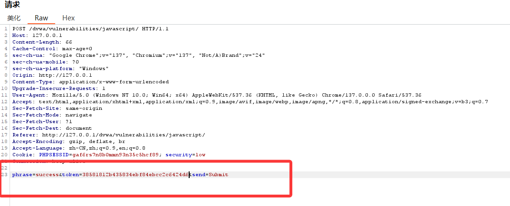
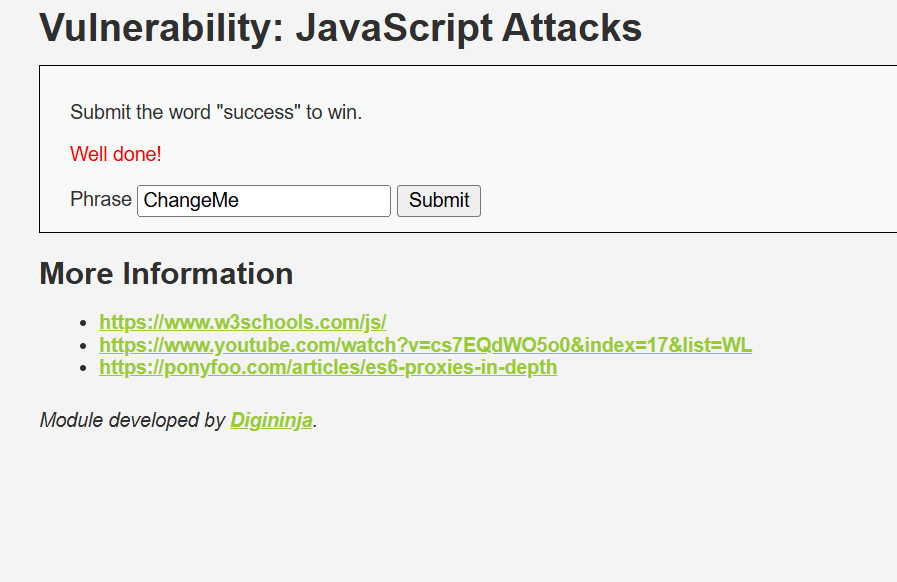

# JavaScript Attacks

页面要提交 `phrase` 和 `token`，token 由前端 JS 算出来放进隐藏字段。这个模块只讲一件事：**前端算出来的东西，攻击者也能算**。逻辑放在前端，等于公开。

## 漏洞在哪

```javascript
document.getElementById("token").value = md5(rot13(document.getElementById("phrase").value));
```

`phrase` 要等于 `success` 才算通过，token 是 `phrase` 的函数。函数在浏览器里，攻击者读一遍就能自己算。

## 等级对照

| 等级 | token 算法 | 构造方式 |
|---|---|---|
| Low | `md5(rot13(phrase))` | `success` → `fhpprff` → 取 MD5 |
| Medium | `"XX" + reverse(phrase) + "XX"` | `success` → `sseccus` → `XXsseccusXX` |
| High | `sha256("XX" + reverse(phrase) + "XX")` | 同上再取 SHA256 |
| Impossible | 服务端生成并校验 | 算不出来 |

## Low

| 项 | 内容 |
|---|---|
| 源码 | `generate_token()` 里调 `md5(rot13(...))` |
| 手算 | `success` → ROT13 得 `fhpprff` → MD5 |
| Token | `38581812b435834ebf84ebcc2c6424d6` |
| 提交 | `phrase=success&token=38581812b435834ebf84ebcc2c6424d6` |

两种提交方式，第二种更贴近真实攻击，因为攻击者根本不打开你的页面：

```javascript
document.querySelector('[name="phrase"]').value = 'success';
document.querySelector('[name="token"]').value = '38581812b435834ebf84ebcc2c6424d6';
```

```
phrase=success&token=38581812b435834ebf84ebcc2c6424d6
```





## Medium

| 项 | 内容 |
|---|---|
| 算法 | `"XX" + reverse(phrase) + "XX"` |
| 验证 | 默认 `ChangeMe` 对应 `XXeMegnahCXX`，能对上 |
| 目标 | `success` → `sseccus` → `XXsseccusXX` |

```text
phrase=success&token=XXsseccusXX
```

这不是加密，是字符串反转。看到默认值就能推出算法。

## High

| 项 | 内容 |
|---|---|
| 算法 | `sha256("XX" + reverse(phrase) + "XX")` |
| 输入 | `XXsseccusXX` |
| 工具 | CyberChef：`SHA2` → `SHA-256` |
| 找算法 | `Ctrl + Shift + F` 全局搜 `token`、`sha`、`XX`、`phrase` |

这一级练的是读代码，不是算哈希。真实项目里 JS 会被压缩，变量名变成 `a`、`b`、`c`，但字符串常量改不掉，从常量入手最快。

## Impossible

token 由服务端生成、与 Session 绑定、服务端校验，前端只负责把值带回去。攻击者能改 `phrase`，算不出对应 token。

## 三档其实是同一个问题

表面上难度在升：ROT13 + MD5 → 反转 → 反转 + SHA256。并排看就发现是同一件事：**校验逻辑在客户端，攻击者就能自己算出一个合法值**。

算法复杂度不构成安全性。ROT13 和 SHA256 在这里地位一样，因为攻击者不需要破哈希，他只需要知道你在算什么。

## 容易记错的地方

- 只改 `phrase` 不改 token 会失败，提交时前端会重算并覆盖手填值，两个一起改或直接走 Burp。
- `querySelector('[name="phrase"]')` 用 name 不用 id，两者不一定相同，用 id 选择器可能返回 null。
- High 搜 `sha256` 搜不到，代码里可能是 `CryptoJS.SHA256`，搜 `SHA` 才有结果。
- `crypto.subtle.digest` 是异步的，控制台里手写容易写错，用工具更省事。

## 怎么修

| 措施 | 作用 |
|---|---|
| 安全判断放服务端 | 前端只做体验 |
| token 服务端生成 | 随机、不可预测、绑 Session |
| 前端不出现密钥与规则 | 算法参数也不放 |
| 接受前端混淆无用 | 压缩代码照样能读 |
